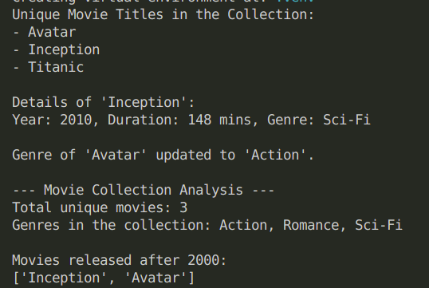

## Pracice Exercise: Organize and Analyze Movie Collection​

### Problem Statement

- Develop a Python program to manage and analyze a collection of movies.​
- The program should allow users to store, access, and update movie details efficiently using Python data structures.​
- The movie details include title, year of release, duration, and genre.

### Context

A film enthusiast wants to organize their growing movie collection for some analytics but finds it difficult to keep track of each movie’s details, such as release year, duration, and genre. They need an efficient system to manage this
information without duplicates.​

Your task is to help them design a Python program that stores, updates, and retrieves movie details easily.

### Task Details

Following steps should be performed to build the solution for this practice. ​

#### Step 1: Store each movie’s details in a list of tuples.​
- Store each movie’s details such as title, year, duration, and genre as tuples inside a list.​
- Each tuple represents one movie whose details cannot be modified once created.

#### Step 2: Create a collection of unique movie titles​
- Use a set to store all unique movie titles from the list of movies.​
- When adding titles, ensure duplicates are automatically ignored.​
- Display the list of unique movie titles.

#### Step 3: Store movie details with title–detail mapping​
- Use a dictionary where each movie title acts as a key and its details (year, duration,genre) are stored as a tuple.​
- This structure enables fast access and easy updates to movie details.

#### Step 4: Display all unique movie titles and their details.​
- Allow users to view the details of a specific movie by searching with its title.​
- If the title exists in the dictionary, display its details; otherwise, print a message
indicating that the movie was not found.

#### Step 5: Update movie genre.​
- Modify the genre of an existing movie by accessing its details through the dictionary.​
- If the movie is found, replace the old genre with the new one and confirm the update.

#### Step 6: Analyze movie collection.
- Display​
    - The total number of unique movies in the collection.​
    - A list of unique genres, created using set comprehension.​
    - Optionally, show a filtered list (e.g., movies released after 2000) using list comprehension to demonstrate list operations.

#### Sample Movie Data:

| Title | Release Year | Duration | Genre 
| --- | --- | --- | --- |
| Inception | 2010 | 148 | Sci-Fi |
| Titanic | 1997 | 195 | Romance |
| Avatar | 2009 | 162 | Sci-Fi |

**Expected Output:**

#### Instructions:

- Create a `UV` project named `p1_movie_collection_app` and implement the required functionality inside the `main,py` file.
- Ensure your code is well-organized and includes comments for clarity.
- Test your code thoroughly to ensure it meets the requirements.

