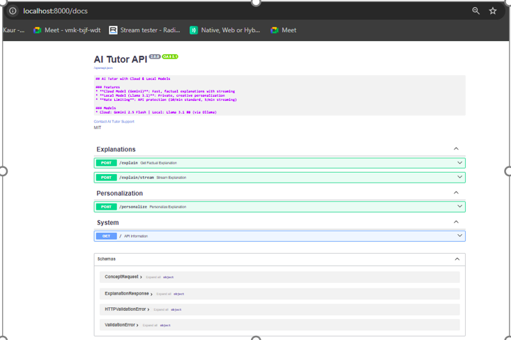
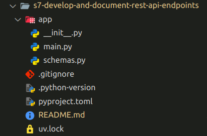

## Study Buddy - Convert Personalised AI Tutor with REST API ​

This practice is a perfect introduction to building AI-powered REST APIs. You’ll transform your console-based tutor into a FastAPI service that serves multiple users with real-time streaming, rate limiting, and structured documentation.

----

### Problem Statement

Transform your console-based AI Tutor into a FastAPI-powered REST API. ​

Implement endpoints for both cloud and local LLM queries, add streaming responses, apply rate limiting, and generate OpenAPI documentation. ​

---

#### Context

A learning platform needs to scale their AI Tutor beyond console access to serve multiple learners across web and mobile platforms simultaneously.  

They require an API that:
- Provides **real-time streaming responses**  
- Protects server resources with **rate limiting**  
- Maintains **auto-generated documentation**  
- Supports both **cloud (e.g., Gemini)** and **local (Ollama)** model integration  

---
#### Task Details

Following steps should be performed to build the solution for this practice. 

### Step 1: Set up the FastAPI project and dependencies​

- Initialize a FastAPI project and install all required libraries (`fastapi`, `uvicorn`, `slowapi`, `python-dotenv`, `openai`).​
- Create an `.env` file to store API keys and configuration variables for your cloud model (e.g., Gemini).

### Step 2: Define Pydantic models for request and response validation.

- Create a `schemas.py` file and add models to structure input (concept requests) and output (explanations with metadata) and error responses.​
- Use these schemas in your API endpoints for cleaner, consistent data handling.

### Step 3: Expose REST API endpoints​

- Define multiple endpoints in your FastAPI app:​
    - `/explain` → Uses a cloud model to provide structured explanations.​
    - `/personalize` → Uses a local model (via Ollama) for creative responses.​
    - `/explain/stream` → Implements Server-Sent Events (SSE) for real-time output streaming.

### Step 4: Implement rate limiting and error handling​

- Integrate `slowAPI` to set per-user rate limits (e.g., 3 requests/min).​
- Handle common API errors such as invalid keys, missing inputs, or timeouts with clear status codes and messages (400, 401, 429, etc.).

### Step 5: Document your API with OpenAPI​

- Leverage FastAPI’s built-in **Swagger UI** and **ReDoc** for auto-generated documentation.​

|Tool| path |Purpose|
|---|---|---|
|Swagger UI|`/docs`|Interactive live testing|
|ReDoc|`/redoc`|Clean, read-only API reference|
|OpenAPI Schema|`/openapi.json`|Machine-readable contract​|

- Include meaningful docstrings and response examples in your endpoint definitions.

----

#### Expected Program Behavior

When the program runs:​

- API server starts with Cloud (Gemini) and Local (Llama 3.1) models initialized.​
- Interactive Swagger UI available at /docs for testing endpoints.​
- `/explain` returns factual explanations from the cloud model in JSON.​
- `/explain/stream` streams explanations word-by-word in real-time.​
- `/personalize` returns creative, personalized explanations from the local model.​
- Rate limiting ensures excessive requests are blocked with 429 errors.

----

### 💡 Expected Output Reference

-----

### Project Structure

-----