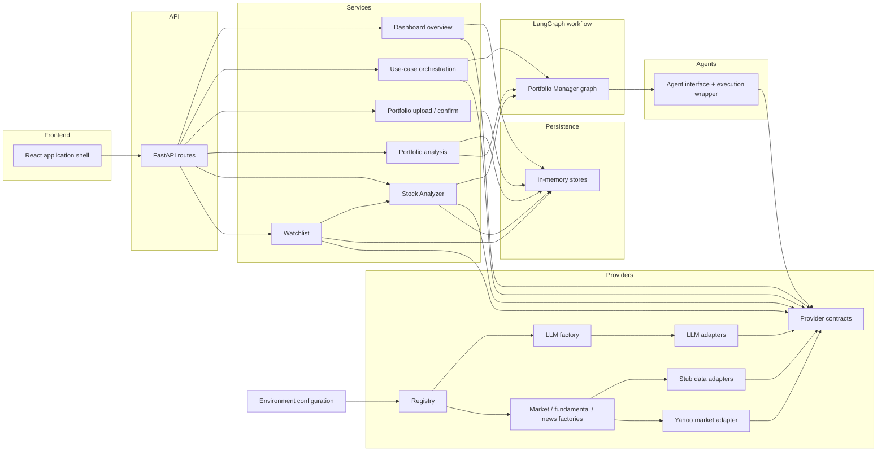
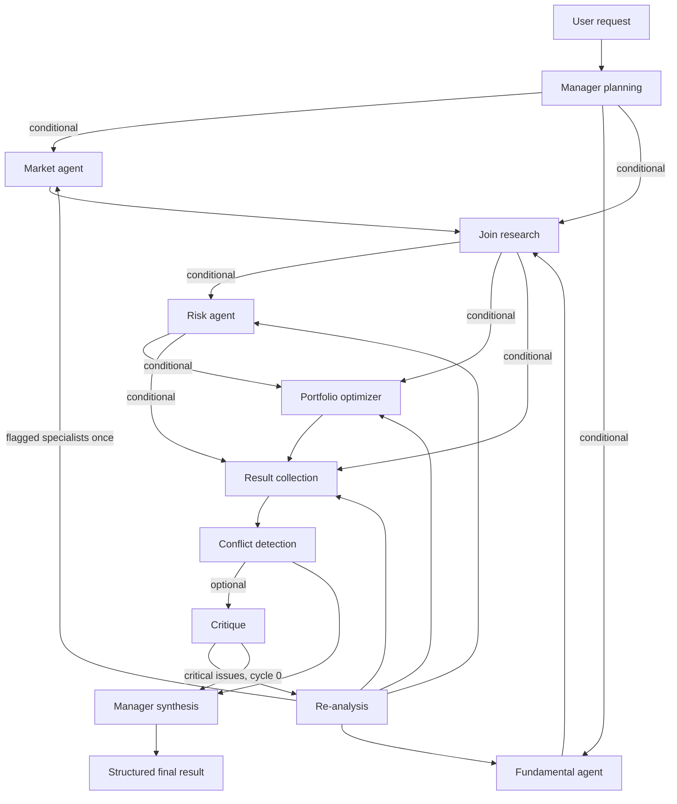

# Autonomous Investment Strategy Board

Prototype of a stateful multi-agent financial decision-support system.

This repository currently contains the **foundation layer**, the **LLM provider abstraction**, the **external-data provider abstraction**, **portfolio upload / validation**, the **investment-analysis agent framework**, the **compiled LangGraph workflow**, the **portfolio workflow HTTP API**, the **Stock Analyzer HTTP API**, the **Watchlist HTTP API**, the **Dashboard overview HTTP API**, and the **frontend**: environment configuration, logging, exception handling, provider-agnostic contracts, Groq / OpenAI / Google / Azure LLM adapters, factory-selected market / fundamental / news adapters including a Yahoo Finance market-data client, CSV/XLSX portfolio ingestion with preview-then-confirm persistence, specialist agents behind a common execution wrapper, a one-shot manager-coordinated graph, HTTP routes for upload, preview, confirm, holdings, summary, and structured portfolio analysis, independent stock search / selection / market / fundamental / analysis routes, watchlist add / list / current-information / remove / Stock Analyzer open routes, a Dashboard overview of NIFTY 50, major indices, and imported-portfolio totals, and a React UI with routing, shared layout, reusable states, typed models, an API service layer, **Dashboard**, **Upload Portfolio**, **Portfolio Analyzer**, **Stock Analyzer**, and **Watchlist** screens.

## Current technology stack

The original repository was an empty GitLab template (README only). The foundation introduces:

| Layer | Choice | Role |
| --- | --- | --- |
| Language | Python 3.11+ | Application runtime |
| API | FastAPI + Uvicorn | HTTP entrypoint |
| Settings | pydantic-settings | Environment-variable configuration |
| LLM | openai + google-genai (behind `LLMProvider`) | Groq, OpenAI, Google, Azure adapters |
| External data | `MarketDataProvider`, `FundamentalDataProvider`, `NewsDataProvider` | Factory-selected adapters; Yahoo Finance for live market data, stub otherwise |
| Portfolio files | openpyxl + csv | CSV/XLSX parsing only; no market enrichment |
| Persistence | In-memory stores | Staged uploads, confirmed portfolios, stock analyses, and watchlist symbols |
| Models | Pydantic v2 | Structured data, provenance, LLM structured output |
| Orchestration | LangGraph (`app/workflow`) | Manager graph with conditional routing and one reflection cycle |
| Tests | pytest + httpx | Foundation, agent, and workflow checks |
| UI | React + TypeScript + Vite | Application shell, routing, and API client |

Live market quotes and Indian index levels are retrieved through the Yahoo Finance adapter when `MARKET_DATA_PROVIDER=yahoo`. LLM vendor SDKs are used only inside `app/providers/llm/` adapters. Market, fundamental, and news vendor SDKs belong only in their adapter modules. Agents must not instantiate LangGraph; `build_strategy_graph` / `invoke_strategy_board` own orchestration.

## Architecture



**Rules encoded in this layout**

- Business logic depends on **provider contracts**, never on a vendor SDK.
- The selected LLM, market-data, fundamental, and news adapters come from environment variables (`LLM_PROVIDER`, `MARKET_DATA_PROVIDER`, `FUNDAMENTAL_DATA_PROVIDER`, `NEWS_PROVIDER`).
- Stub adapters refuse to invent prices, fundamentals, or headlines.
- Agents run through an execution wrapper (logging, timing, errors, evidence). They must not start their own graphs, instantiate an LLM adapter, or hardcode a provider.
- The LangGraph workflow plans once, fans out independent specialists, collects results, records conflicts, optionally critiques, may re-run flagged specialists once, and synthesizes a structured recommendation. It does not loop.
- Deterministic calculations belong in `app/tools`; LLMs are for interpretation, routing, critique, and synthesis only. Chain-of-thought is not returned.
- The uploaded portfolio is the **only** user-provided financial dataset. Upload does not call market, fundamental, or news providers.
- A staged preview is not available as a portfolio until the client **confirms** import.
- Frontend screens are independently developed: each page owns its data loading and talks to the API client, not to other screens.

Prototype graph (one request, at most one re-analysis cycle):



Market and fundamental run in parallel when both are requested. Risk and the optimizer run only when the plan needs them and a portfolio (uploaded or synthetic) is available. Critique runs when structured findings exist. Critical findings may re-invoke flagged specialists once; remaining issues are recorded as unresolved and synthesis always follows.

## Project structure

```text
app/
  main.py                 # Application factory and startup
  exceptions.py           # Shared error types
  config/                 # Settings and logging
  api/                    # HTTP routes, deps, exception handlers
  agents/                 # Manager + market, fundamental, risk, optimizer specialists
  workflow/               # InvestmentState, compiled LangGraph graph, node mapping
  providers/              # Contracts, registry, LLM + data-provider factories, stub adapters
  tools/                  # Deterministic tools (portfolio parsing, later risk math)
  models/                 # Shared Pydantic models (quotes, statements, news, portfolio, stock, watchlist)
  services/              # Use-case services (upload, analysis mapping, stock retrieval, watchlist)
  repositories/           # Persistence contracts (in-memory portfolio, stock-analysis, and watchlist stores)
tests/                    # Foundation, portfolio, agent, and workflow tests
frontend/                 # React application shell
  src/api/                # Typed HTTP client split by domain
  src/models/             # Frontend contracts matching the API
  src/components/         # Shared UI, loading, error, and empty states
  src/layout/             # Navigation and app chrome
  src/pages/              # One independently developed screen per file
.env.example              # Documented configuration
```

## Configuration

Copy `.env.example` to `.env` and adjust values. `.env` is gitignored.

Provider selection is configuration, not code:

```text
LLM_PROVIDER=groq
FALLBACK_LLM_PROVIDER=openai
MARKET_DATA_PROVIDER=yahoo
FUNDAMENTAL_DATA_PROVIDER=stub
NEWS_PROVIDER=stub
```

LLM adapters: `stub`, `openai`, `groq`, `google`, `azure`. Each vendor reads its own model and API key (`OPENAI_LLM_MODEL` / `OPENAI_LLM_API_KEY`, and the Groq, Google, and Azure equivalents). Azure also needs `AZURE_LLM_ENDPOINT`. If the primary LLM times out or fails, the configured fallback is tried once.

Adding another LLM vendor means a new adapter under `app/providers/llm/` and a registry entry in `app/providers/llm/factory.py`. Agents keep calling the `LLMProvider` contract (`complete`, `complete_structured`) through `AgentRuntime`; they never construct a vendor client.

Market adapters: `stub`, `yahoo` (alias `yfinance`). Fundamental and news adapters in this layer: `stub` only. The contracts are provider-independent:

- `MarketDataProvider`: instrument search, current quote, historical OHLC, index information, volume, basic market information
- `FundamentalDataProvider`: company profile, financial statements, key financial metrics, valuation metrics
- `NewsDataProvider`: company news, market news

Adding a data vendor means a new adapter under `app/providers/market_data/`, `app/providers/fundamentals/`, or `app/providers/news/` plus a registry entry in that package's `factory.py`. Agents and services keep calling the generic interfaces.

Secrets (`*_API_KEY`) stay in the environment and are never logged. The `/health` endpoint reports adapter names only.

## Run

```bash
python -m venv .venv
.venv\Scripts\activate
pip install -r requirements.txt
copy .env.example .env
python -m app
```

The API listens on `APP_HOST`/`APP_PORT` (default `http://127.0.0.1:8000`).

Frontend (from `frontend/`):

```bash
cd frontend
npm install
npm run dev
```

The UI listens on `http://127.0.0.1:5173` and proxies API calls to the backend. Dashboard, Upload Portfolio, Portfolio Analyzer, Stock Analyzer, and Watchlist are implemented independently. Dashboard is an overview and entry point; it does not run specialist analysis.

- Health: `GET /health`
- Dashboard overview: `GET /dashboard`
- Portfolio upload + validate: `POST /portfolios/uploads`
- Portfolio preview: `GET /portfolios/uploads/{upload_id}`
- Confirm import: `POST /portfolios/uploads/{upload_id}/confirm`
- Imported portfolios: `GET /portfolios`
- Portfolio summary: `GET /portfolios/{portfolio_id}/summary`
- Portfolio holdings: `GET /portfolios/{portfolio_id}/holdings`
- Confirmed portfolio: `GET /portfolios/{portfolio_id}`
- Submit analysis: `POST /portfolios/{portfolio_id}/analysis`
- Stored analyses: `GET /portfolios/{portfolio_id}/analysis`
- Analysis result: `GET /portfolios/{portfolio_id}/analysis/{analysis_id}`
- Stock search: `GET /stocks/search?q=`
- Stock selection: `POST /stocks/select`
- Current stock information: `GET /stocks/{symbol}`
- Market data: `GET /stocks/{symbol}/market`
- Fundamental data: `GET /stocks/{symbol}/fundamentals`
- Suggested questions: `GET /stocks/{symbol}/questions`
- Stock analysis: `POST /stocks/{symbol}/analysis`
- Stored stock analyses: `GET /stocks/{symbol}/analysis`
- Stock analysis result: `GET /stocks/{symbol}/analysis/{analysis_id}`
- Watchlist: `GET /watchlist`
- Add to watchlist: `POST /watchlist`
- Watchlist stock information: `GET /watchlist/{symbol}`
- Remove from watchlist: `DELETE /watchlist/{symbol}`
- Open watchlist stock in Stock Analyzer: `POST /watchlist/{symbol}/open`
- OpenAPI: `/docs`

Supported prototype files: CSV and XLSX. Required columns: `symbol` (aliases: ticker, instrument) and `quantity` (aliases: qty, shares, units). Optional columns: `average_cost`, `currency`, `name`, `weight`. Validation errors and warnings are returned as structured `issues`. Confirmation is rejected until every error is resolved. Upload does not attach market prices.

Portfolio analysis accepts a question against an imported portfolio, runs the one-shot manager graph, and returns a structured result (recommendation, specialist summaries, critique findings, evidence with source metadata, risk/optimization snapshots). Graph node names, specialist extras, prompts, and chain-of-thought are not returned.

Stock Analyzer search, selection, current information, market data, fundamentals, suggested questions, and custom questions work without an uploaded portfolio. Retrieved figures come from the configured market and fundamental adapters. AI stock analysis runs the same one-shot manager graph with `analysis_type=stock_analysis` and returns evidence with source metadata. The Stock Analyzer screen can add the selected symbol to Watchlist without leaving the page; Watchlist itself does not run AI analysis. Opening a holding from Portfolio Analyzer still uses this independent single-stock view.

The Dashboard is a lightweight overview. It shows NIFTY 50, major Indian indices, current-day performance, market session, and the data timestamp from the configured market-data adapter. When a portfolio has been imported, it also shows portfolio value, allocation, holding count, and high-level concentration / diversification labels. Missing quotes stay blank. Detailed Q&A stays on Portfolio Analyzer and Stock Analyzer.

The Watchlist is a monitoring and navigation feature. The screen lists watched symbols with current price, day change, percentage change, and last-updated time. It can add, list, refresh current information for, and remove symbols. Duplicate symbols are rejected. Invalid or unknown symbols are not added. If a monitored symbol later becomes unavailable, list and current-information routes keep the entry and record the gap instead of inventing prices. Opening a watchlist symbol reuses Stock Analyzer selection (`/stocks/{symbol}`) and does not run AI analysis.

## Test

```bash
pytest
```

## Intentionally not in this task

- Live fundamental or news vendor APIs
- Brokerage or trade execution
- Continuous autonomous agent loops
