# C3 LegalDoc Navigator — Architecture Documentation

Production-grade **AI Legal Document Analysis System** built with Python 3.12, FastAPI, LlamaIndex, PostgreSQL 16 + pgvector, and a React frontend. The system ingests legal documents (PDF, DOCX, TXT), indexes them for semantic search, and answers natural-language questions via RAG, structured SQL retrieval, or a hybrid of both—with optional external legal database search via MCP.

---

## Table of Contents

1. [System Architecture](#1-system-architecture)
2. [Sequence Diagrams](#2-sequence-diagrams)
3. [Class Diagram](#3-class-diagram)
4. [Entity-Relationship Diagram](#4-entity-relationship-diagram)
5. [RAG Pipeline](#5-rag-pipeline)
6. [Query Router](#6-query-router)
7. [Hybrid Retrieval Flow](#7-hybrid-retrieval-flow)
8. [Guardrails](#8-guardrails)
9. [Deployment Diagram](#9-deployment-diagram)

---

## 1. System Architecture

The application follows **Clean Architecture**: dependencies flow inward from presentation → application → domain → infrastructure.

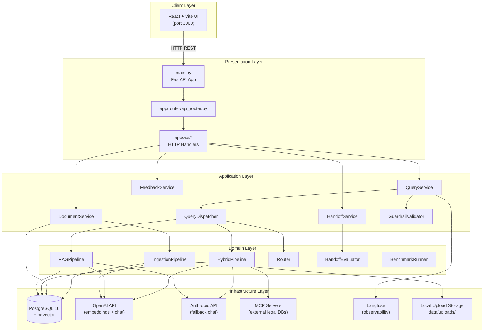

### Layer Responsibilities

| Layer | Packages | Responsibility |
|---|---|---|
| **Presentation** | `app/api/`, `app/router/`, `app/main.py` | HTTP routing, request validation, response mapping |
| **Application** | `app/services/`, `app/guardrails/` | Use-case orchestration, guardrail enforcement |
| **Domain** | `app/ingestion/`, `app/rag/`, `app/routing/`, `app/handoff/`, `app/evaluation/` | Business logic, retrieval pipelines, routing |
| **Infrastructure** | `app/database/`, `app/core/`, `app/mcp/`, `app/utils/` | Persistence, config, external integrations |

### API Endpoints

| Method | Path | Description |
|---|---|---|
| `GET` | `/health` | Service health check |
| `POST` | `/upload` | Upload and index a legal document |
| `GET` | `/documents` | Paginated document list |
| `GET` | `/document/{document_id}` | Document detail |
| `POST` | `/query` | RAG / SQL / hybrid Q&A |
| `POST` | `/feedback` | Submit user rating (1–5) |
| `POST` | `/handoff` | Evaluate or create human escalation |

---

## 2. Sequence Diagrams

### 2.1 Document Upload & Indexing

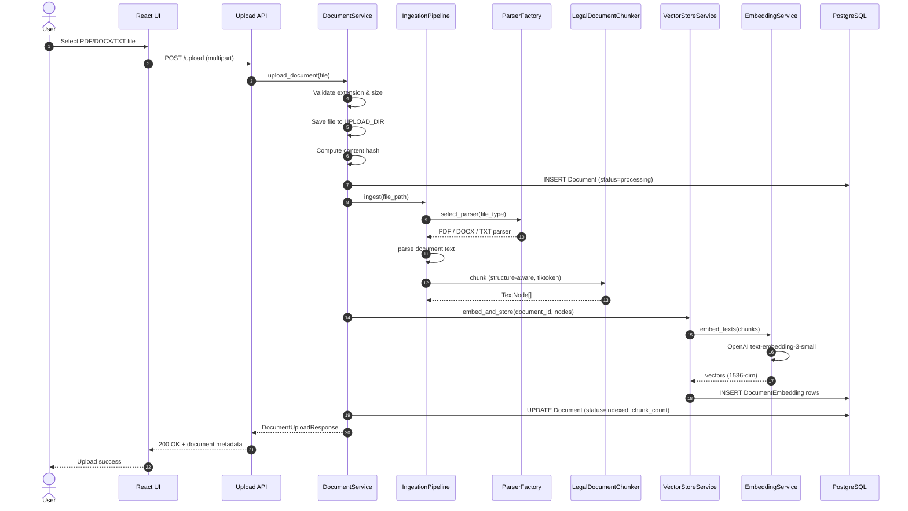

### 2.2 Query Processing (Full Lifecycle)

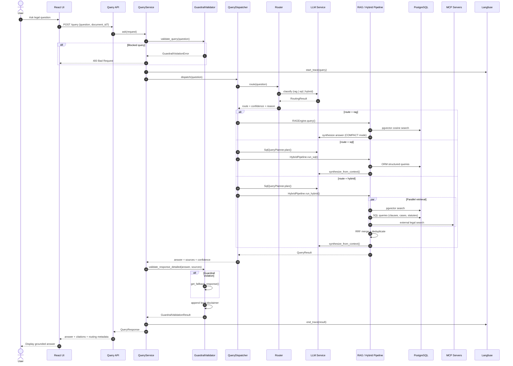

### 2.3 Human Handoff Escalation

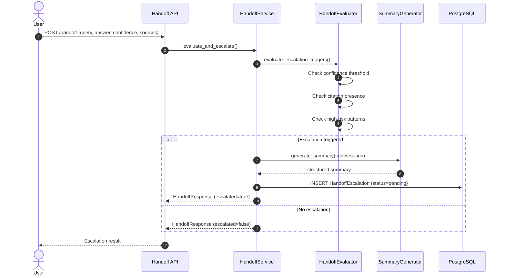

---

## 3. Class Diagram

Core classes across the application, domain, and infrastructure layers.

```mermaid
classDiagram
    direction TB

    %% Presentation
    class FastAPIApp {
        +create_app() FastAPI
        +lifespan()
    }

    %% Application Services
    class QueryService {
        -guardrail_validator: GuardrailValidator
        -dispatcher: QueryDispatcher
        +ask(request: QueryRequest) QueryResponse
    }

    class DocumentService {
        -ingestion_pipeline: IngestionPipeline
        -vector_store: VectorStoreService
        +upload_document(file) DocumentUploadResponse
        +list_documents() list
        +get_document(id) DocumentDetail
    }

    class QueryDispatcher {
        -router: Router
        -rag_engine: RAGEngine
        -hybrid_pipeline: HybridPipeline
        -sql_planner: SqlQueryPlanner
        +dispatch(question) QueryResult
    }

    class LLMService {
        +get_llm(provider) LLM
    }

    class EmbeddingService {
        +embed_texts(texts) list~vector~
    }

    class SearchService {
        +search(query, top_k) list~SearchHit~
    }

    class VectorStoreService {
        +embed_and_store(doc_id, nodes) int
    }

    %% Domain - Routing
    class Router {
        -registry: RouteRegistry
        -llm_service: LLMService
        +route(query) RoutingResult
    }

    class RouteRegistry {
        -routes: dict
        +register(route: RouteDefinition)
        +names() frozenset
    }

    class RoutingResult {
        +route: str
        +reason: str
        +confidence: float
    }

    %% Domain - RAG
    class RAGPipeline {
        -session: AsyncSession
        -llm_service: LLMService
        -embedding_service: EmbeddingService
        +run(question) RAGPipelineResult
    }

    class RAGEngine {
        -pipeline: RAGPipeline
        +query(question) RAGPipelineResult
    }

    class LegalDocumentRetriever {
        -search_service: SearchService
        +aretrieve(query_bundle) list~Node~
    }

    class LegalContextBuilder {
        +build(nodes) str
    }

    class LegalResponseSynthesizer {
        -llm: LLM
        +synthesize(question, context) str
        +synthesize_from_context(question, nodes) str
    }

    class HybridPipeline {
        -session: AsyncSession
        -sql_planner: SqlQueryPlanner
        -external_search: ExternalLegalSearchService
        +run_hybrid(question, plan) HybridPipelineResult
        +run_sql(question, plan) HybridPipelineResult
    }

    class SqlQueryPlanner {
        +plan(question) SqlQueryPlan
    }

    class SqlQueryExecutor {
        +execute(plan) SqlRetrievalResult
    }

    %% Domain - Ingestion
    class IngestionPipeline {
        -parser_factory: ParserFactory
        -chunker: LegalDocumentChunker
        +ingest(path) list~TextNode~
    }

    class ParserFactory {
        +select_parser(file_type) DocumentParser
    }

    class LegalDocumentChunker {
        +chunk(text, metadata) list~TextNode~
    }

    %% Guardrails
    class GuardrailValidator {
        -guard: Guard
        +validate_query(query) void
        +validate_response_detailed(response) GuardrailValidationResult
    }

    class LegalAdviceDetector {
        +validate(value, metadata) ValidationResult
    }

    class CitationRequiredValidator {
        +validate(value, metadata) ValidationResult
    }

    class UnsupportedClaimDetector {
        +validate(value, metadata) ValidationResult
    }

    %% MCP
    class ExternalLegalSearchService {
        -connection_manager: MCPConnectionManager
        +search(query) ExternalSearchResult
    }

    class MCPConnectionManager {
        +search_all(query) list~ExternalLegalHit~
    }

    %% Relationships
    FastAPIApp --> QueryService
    FastAPIApp --> DocumentService
    QueryService --> GuardrailValidator
    QueryService --> QueryDispatcher
    QueryDispatcher --> Router
    QueryDispatcher --> RAGEngine
    QueryDispatcher --> HybridPipeline
    QueryDispatcher --> SqlQueryPlanner
    Router --> RouteRegistry
    Router --> LLMService
    RAGEngine --> RAGPipeline
    RAGPipeline --> LegalDocumentRetriever
    RAGPipeline --> LegalContextBuilder
    RAGPipeline --> LegalResponseSynthesizer
    RAGPipeline --> SearchService
    HybridPipeline --> LegalDocumentRetriever
    HybridPipeline --> SqlQueryExecutor
    HybridPipeline --> ExternalLegalSearchService
    HybridPipeline --> LegalResponseSynthesizer
    DocumentService --> IngestionPipeline
    DocumentService --> VectorStoreService
    IngestionPipeline --> ParserFactory
    IngestionPipeline --> LegalDocumentChunker
    SearchService --> EmbeddingService
    VectorStoreService --> EmbeddingService
    GuardrailValidator --> LegalAdviceDetector
    GuardrailValidator --> CitationRequiredValidator
    GuardrailValidator --> UnsupportedClaimDetector
    ExternalLegalSearchService --> MCPConnectionManager
    LegalDocumentRetriever --> SearchService
    SqlQueryPlanner --> LLMService
    LegalResponseSynthesizer --> LLMService
```

---

## 4. Entity-Relationship Diagram

PostgreSQL schema managed by Alembic migrations (`alembic/versions/001`–`005`).

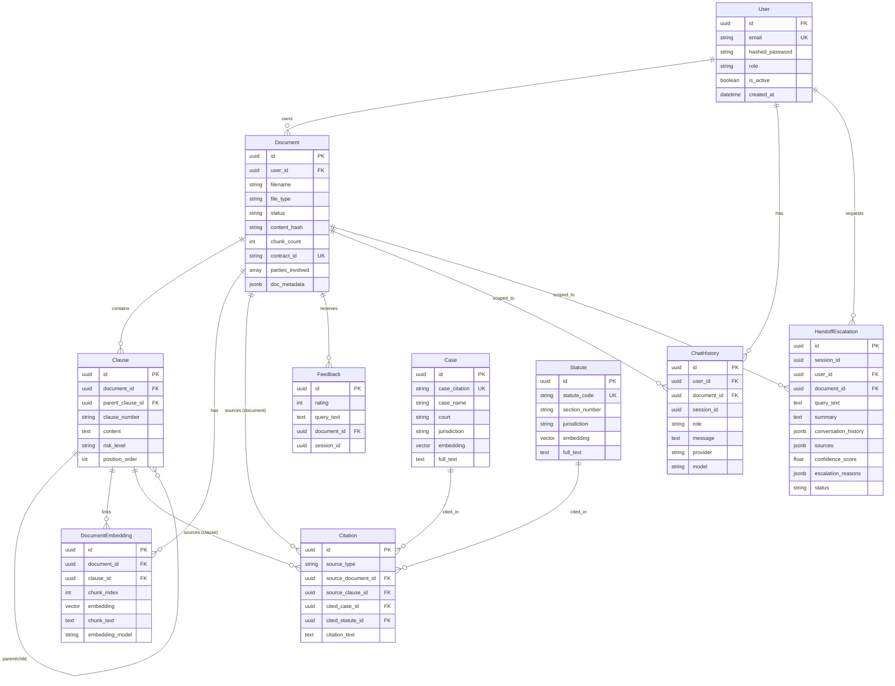

> **Note:** Upload currently populates `documents` and `document_embeddings`. The `clauses`, `cases`, `statutes`, and `citations` tables support structured SQL and hybrid retrieval when pre-seeded with reference data.

---

## 5. RAG Pipeline

The RAG pipeline performs semantic retrieval over document embeddings stored in pgvector, then synthesizes a grounded answer using LlamaIndex COMPACT mode.

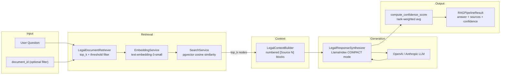

### RAG Configuration

| Parameter | Default | Description |
|---|---|---|
| `CHUNK_SIZE` | 1024 | Token chunk size during ingestion |
| `CHUNK_OVERLAP` | 128 | Overlap between consecutive chunks |
| `TOP_K_RETRIEVAL` | 5 | Number of chunks retrieved per query |
| `SIMILARITY_THRESHOLD` | 0.7 | Minimum cosine similarity score |
| `VECTOR_DIMENSION` | 1536 | Embedding vector size |
| `OPENAI_EMBEDDING_MODEL` | text-embedding-3-small | Embedding model |

### Pipeline Stages

1. **Embed query** — Convert the user question to a 1536-dimensional vector via OpenAI.
2. **Vector search** — Query `document_embeddings` using pgvector IVFFlat cosine distance, optionally scoped to a single document.
3. **Build context** — Format retrieved chunks into numbered source blocks for the LLM prompt.
4. **Synthesize** — LlamaIndex COMPACT synthesis generates an answer grounded in the retrieved context.
5. **Score confidence** — Rank-weighted average of retrieval similarity scores (0.0–1.0).

---

## 6. Query Router

An LLM-powered classifier selects the optimal retrieval strategy based on query intent.

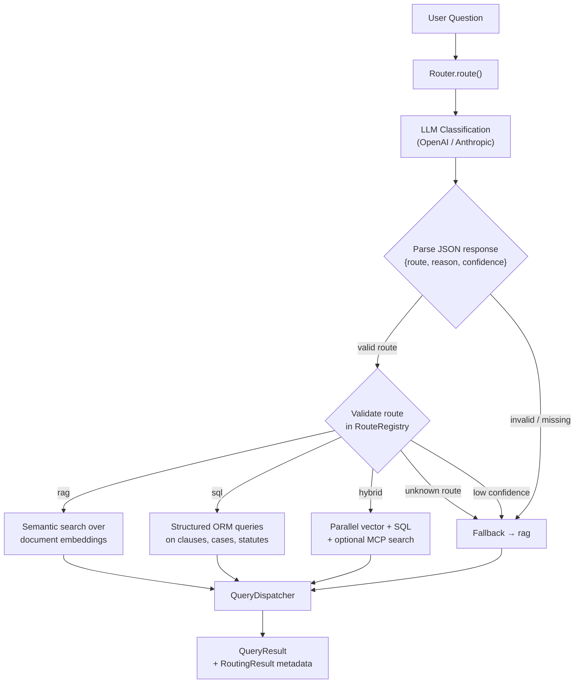

### Route Definitions

| Route | Use Case | Example Queries |
|---|---|---|
| **rag** | Semantic search over document text | "Summarize this NDA", "What does the indemnity clause say?" |
| **sql** | Structured metadata / entity lookups | "List all high-risk clauses", "Find cases citing Section 12" |
| **hybrid** | Combined semantic + structured + external | "Compare indemnity terms with relevant case law" |

### Fallback Behavior

The router falls back to `rag` when:
- LLM response is not valid JSON
- Route name is not in the registry
- Confidence is below the configured threshold

---

## 7. Hybrid Retrieval Flow

Hybrid mode runs three retrieval paths in parallel, merges results via Reciprocal Rank Fusion (RRF), deduplicates, and synthesizes a unified answer.

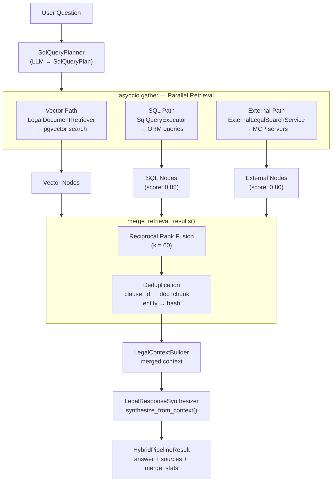

### Merge Strategy

| Step | Detail |
|---|---|
| **RRF scoring** | `score = Σ 1/(k + rank)` across vector, SQL, and external ranked lists (k=60) |
| **Dedup keys** | `clause_id` → `document_id + chunk_index` → `source_type + entity_id` → content hash |
| **SQL node score** | Fixed at 0.85 |
| **External node score** | Fixed at 0.80 |
| **Max results** | `top_k × 2` after merge |

### MCP External Search

When `MCP_ENABLED=true`, the hybrid pipeline queries configured MCP servers (CourtListener, etc.) via stdio, SSE, or streamable HTTP transports. Failures degrade gracefully to empty external results.

---

## 8. Guardrails

Multi-layer safety enforcement for legal AI compliance, built on Guardrails AI with custom validators.

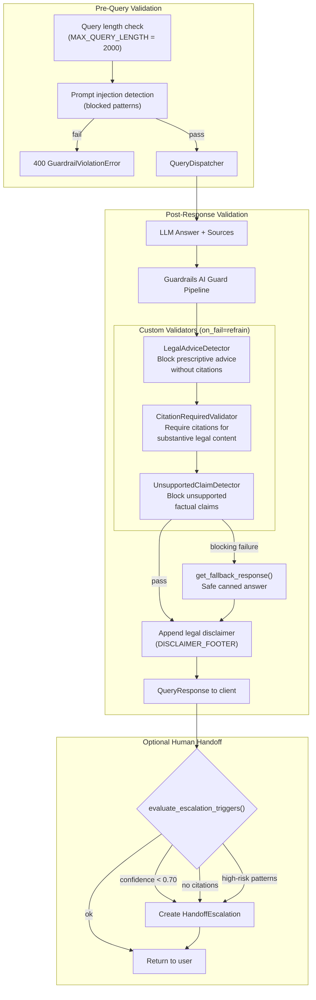

### Guardrail Controls

| Control | Setting | Default |
|---|---|---|
| Master toggle | `ENABLE_GUARDRAILS` | `true` |
| Max query length | `MAX_QUERY_LENGTH` | 2000 |
| Handoff threshold | `HANDOFF_CONFIDENCE_THRESHOLD` | 0.70 |
| Sync validation | `GUARDRAILS_RUN_SYNC` | `true` |

### Escalation Triggers

1. Confidence score below 0.70
2. No supporting citations in the answer (unless "insufficient information" response)
3. High-risk legal advice patterns detected in the question

---

## 9. Deployment Diagram

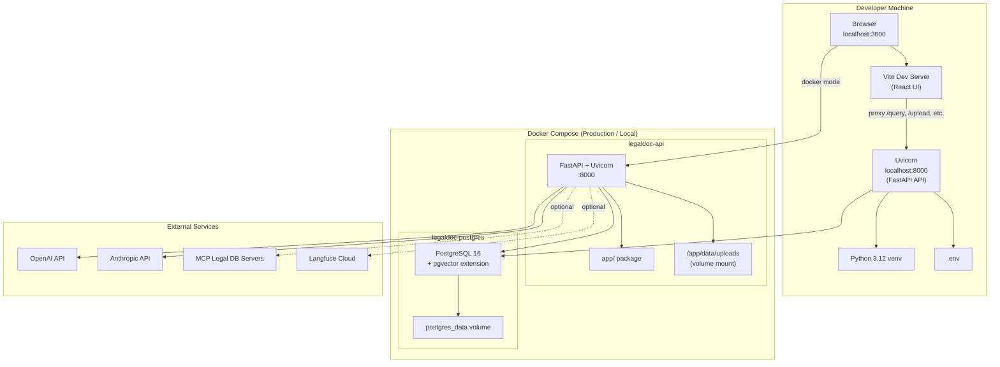

### Deployment Options

| Mode | Command | Components |
|---|---|---|
| **Local dev (API only)** | `uvicorn app.main:app --reload` | Python venv + local/Docker Postgres |
| **Local dev (full stack)** | `docker compose up -d postgres` + API + `npm run dev` | Postgres in Docker, API + UI on host |
| **Docker full stack** | `docker compose up --build` | API + Postgres containers |
| **Frontend production** | `npm run build` → serve `dist/` | Static build with `VITE_API_BASE_URL` |

### Container Details

| Service | Image / Build | Port | Volumes |
|---|---|---|---|
| `api` | `Dockerfile` (Python 3.12-slim) | 8000 | `./data/uploads:/app/data/uploads` |
| `postgres` | `pgvector/pgvector:pg16` | 5432 | `postgres_data`, `scripts/init-db.sql` |

### Database Migrations

```bash
alembic upgrade head
```

Runs migrations `001` (initial schema) through `005` (handoff escalations table).

---

## Related Documentation

- [README](../README.md) — Setup instructions and quick start
- [`.env.example`](../.env.example) — Full environment variable reference
- OpenAPI docs — `http://localhost:8000/docs` (when running)
