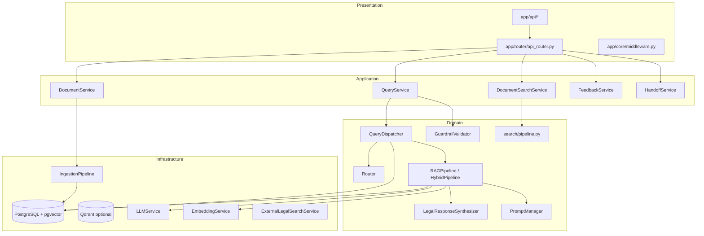
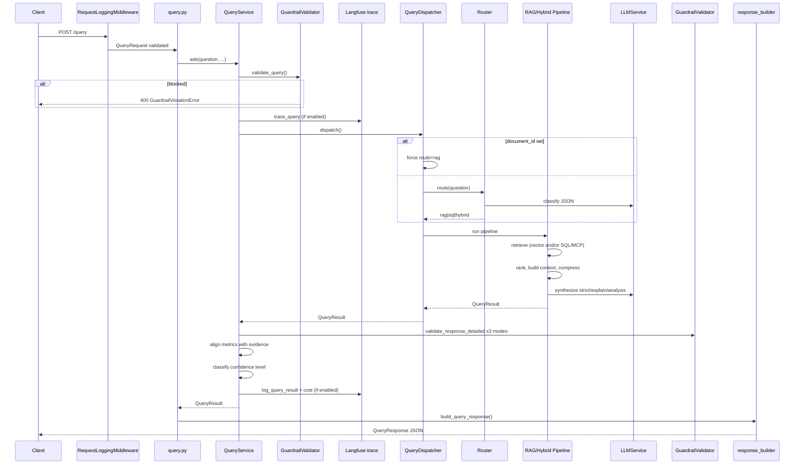

# Architecture Analysis

## Overall Architecture Style

The project follows a **layered / clean architecture** variant:

- **Presentation:** FastAPI routers (`app/api/`)
- **Application:** Service orchestration (`app/services/`)
- **Domain:** RAG pipelines, routing, search, prompts, guardrails (`app/rag/`, `app/routing/`, `app/search/`, `app/prompts/`, `app/guardrails/`)
- **Infrastructure:** Database, ingestion, MCP, storage (`app/database/`, `app/ingestion/`, `app/mcp/`, `app/services/storage_service.py`)

There is no strict domain/infrastructure inversion — RAG classes directly depend on LlamaIndex (`NodeWithScore`, `QueryBundle`, `TextNode`) and SQLAlchemy sessions.

---

## Layer Separation

---

## Entry Point

**File:** `app/main.py`

| Component | Function |
|-----------|----------|
| `lifespan()` | Startup: logging, LLM config log, Langfuse init, DB `SELECT 1`, optional Qdrant collection |
| `create_app()` | Builds FastAPI with middleware, exception handlers, router |
| `app` | Module singleton for Uvicorn |

**Run:** `uvicorn app.main:app --host 0.0.0.0 --port 8000`

**Note:** `settings.API_V1_PREFIX` (`/api/v1`) is defined but **not applied** — endpoints are at root (`/query`, `/upload`, etc.).

---

## API Layer

**Router:** `app/router/api_router.py`

| Method | Path | Handler | Service |
|--------|------|---------|---------|
| GET | `/health` | `health_check` | — |
| POST | `/upload` | `upload_document` | `DocumentService` |
| POST | `/query` | `query_documents` | `QueryService` |
| POST | `/search` | `keyword_search` | `DocumentSearchService` |
| GET | `/documents` | `list_documents` | `DocumentService` |
| GET | `/document/{id}` | `get_document` | `DocumentService` |
| POST | `/feedback` | `submit_feedback` | `FeedbackService` |
| POST | `/handoff` | `create_handoff` | `HandoffService` |

**Middleware order:**
1. `RequestLoggingMiddleware` — logs method, path, status, latency
2. `CORSMiddleware` — `settings.CORS_ORIGINS`

**Exception handlers:** `AppException`, `HTTPException`, `RequestValidationError`, unhandled `Exception` → JSON `ErrorResponse`

---

## Service Layer

| Service | File | Responsibility |
|---------|------|----------------|
| `QueryService` | `query_service.py` | Guardrails, dispatch, metrics alignment, Langfuse |
| `QueryDispatcher` | `query_dispatcher.py` | Route selection, pipeline invocation |
| `DocumentService` | `document_service.py` | Upload, list, get documents |
| `DocumentSearchService` | `app/search/service.py` | BM25 + semantic search (no LLM) |
| `SearchService` | `search_service.py` | Dense vector search (pgvector/Qdrant) |
| `BM25SearchService` | `bm25_search_service.py` | In-memory BM25 over chunks |
| `SqlQueryPlanner` | `sql_query_planner.py` | LLM → structured SQL plan |
| `SqlQueryExecutor` | `sql_query_executor.py` | Execute SQL retrieval |
| `LLMService` | `llm_service.py` | Multi-provider LLM calls |
| `EmbeddingService` | `embedding_service.py` | Text embeddings |
| `VectorStoreService` | `vector_store_service.py` | Embed + persist chunks on upload |
| `ContextCompressionService` | `context_compression_service.py` | Pre-LLM context trimming |
| `FeedbackService` | `feedback_service.py` | Persist user ratings |
| `HandoffService` | `handoff_service.py` | Human escalation |

---

## Domain Layer

| Module | Key classes |
|--------|-------------|
| `app/rag/pipeline.py` | `RAGPipeline` — dense retrieve → synthesize |
| `app/rag/hybrid_pipeline.py` | `HybridPipeline` — parallel SQL + vector + MCP |
| `app/rag/merge.py` | `merge_retrieval_results`, `sql_results_to_nodes` |
| `app/rag/ranking.py` | `rank_retrieval_results`, dedup, overlap merge |
| `app/rag/synthesizer.py` | `LegalResponseSynthesizer` — multi-mode LLM |
| `app/rag/context_builder.py` | `LegalContextBuilder` — numbered source blocks |
| `app/rag/confidence.py` | `compute_confidence_score`, `compute_confidence` |
| `app/routing/router.py` | `Router` — LLM query classifier |
| `app/search/pipeline.py` | `retrieve_search_hits` — BM25 + semantic RRF |
| `app/prompts/manager.py` | `PromptManager` |
| `app/guardrails/validator.py` | `GuardrailValidator` |

---

## Infrastructure Layer

| Component | Files |
|-----------|-------|
| Database | `app/database/session.py` — async engine, `get_db()` |
| ORM models | `app/models/orm.py` |
| Ingestion | `app/ingestion/pipeline.py`, parsers, chunker, OCR |
| MCP | `app/mcp/client.py`, `search.py`, `connection_manager.py` |
| Storage | `app/services/storage_service.py` — local/S3/Supabase |
| Qdrant | `app/services/qdrant_service.py` |

---

## Database Layer

- **Engine:** `create_async_engine(settings.DATABASE_URL, pool_pre_ping=True)`
- **Session:** `AsyncSessionLocal` via `get_db()` — auto-commit on success
- **Vector:** pgvector cosine distance on `document_embeddings.embedding` (default) or Qdrant external store
- **Migrations:** Alembic in `alembic/versions/`

---

## External Integrations

| Integration | Config | Usage |
|-------------|--------|-------|
| OpenAI / Anthropic / Gemini / Groq / Azure | `app/core/config.py` | LLM + embeddings |
| Langfuse | `ENABLE_LANGFUSE`, `LANGFUSE_*` | Tracing, scores (optional) |
| MCP legal databases | `MCP_ENABLED`, `MCP_SERVERS` | Hybrid route external search |
| Qdrant | `VECTOR_BACKEND=qdrant` | Alternative vector store |
| S3 / Supabase | `STORAGE_BACKEND` | Document file storage |
| Tesseract | System binary | Scanned PDF OCR |

---

## Dependency Injection

**File:** `app/dependencies.py`

- **Singletons (`@lru_cache`):** `PromptManager`, `EmbeddingService`, `LLMService`, `GuardrailValidator`, `Router`, `SqlQueryPlanner`, `ExternalLegalSearchService`, `ContextCompressionService`
- **Per-request (`Depends(get_db)`):** `RAGPipeline`, `HybridPipeline`, `QueryDispatcher`, `QueryService`, `DocumentService`, `BM25SearchService`, `DocumentSearchService`

Pattern: constructor injection in dataclass services; manual defaults (`x or ConcreteClass()`) for test overrides.

---

## Configuration Management

**File:** `app/core/config.py` — `Settings(BaseSettings)` loaded from `.env`

Key groups: app, database, vector backend, LLM providers, RAG params, BM25/search thresholds, guardrails, MCP, Langfuse, evaluation paths.

Validators at import: LLM keys required, database URL assembly, vector/storage backend consistency.

---

## Complete Request Lifecycle: `POST /query`

### Step-by-step

1. **HTTP ingress** — FastAPI validates `QueryRequest` (`question`, optional `document_id`, `top_k`, etc.)
2. **Pre-query guardrails** — Length check, blocked injection phrases (`GuardrailValidator.validate_query`)
3. **Tracing** — Langfuse `trace_query` context manager (if `ENABLE_LANGFUSE`)
4. **Routing** — If `document_id`: force `rag`. Else `Router.route()` LLM classifies to `rag`, `sql`, or `hybrid`
5. **Retrieval**
   - **RAG:** `RAGPipeline.retrieve` → dense vector → `rank_retrieval_results` → context build → compression → evidence validation
   - **SQL:** `HybridPipeline.retrieve_sql` → structured DB → nodes → rank
   - **Hybrid:** Parallel SQL + vector + MCP → `merge_retrieval_results` (RRF) → rank
6. **Synthesis** — `LegalResponseSynthesizer.synthesize_all_modes_from_context` generates strict, explain, analysis (+ optional `AnalysisEvaluation`)
7. **Post-response guardrails** — Each mode validated; failures → `get_fallback_response()`
8. **Metrics** — Faithfulness, relevance, confidence from `analysis_evaluation` or `answer_metrics`; `_align_metrics_with_evidence` caps scores when evidence weak
9. **Confidence level** — `classify_confidence_level` → High/Medium/Low + optional verification notice
10. **Cost logging** — `estimate_cost()` → Langfuse when enabled
11. **Response build** — `build_query_response()` formats citations, follow-ups, related documents
12. **DB session** — `get_db` commits if any writes occurred
13. **Middleware** — Request latency logged

---

## Design Patterns

| Pattern | Usage |
|---------|-------|
| Dependency Injection | FastAPI `Depends`, `@lru_cache` factories |
| Strategy | LLM provider selection, vector backend (pgvector vs Qdrant) |
| Pipeline | `RAGPipeline`, `HybridPipeline`, `IngestionPipeline` |
| Router / Classifier | `Router` for query intent |
| Facade | `RAGEngine` over `RAGPipeline` |
| Dataclass services | Most orchestrators are `@dataclass` with injected deps |
| Fallback | Guardrail failures, routing failures → safe defaults |

---

## Related Documents

- [04_FEATURE_MAPPING.md](./04_FEATURE_MAPPING.md)
- [05_RETRIEVAL_PIPELINE_ANALYSIS.md](./05_RETRIEVAL_PIPELINE_ANALYSIS.md)
- [09_DEPENDENCY_MAP.md](./09_DEPENDENCY_MAP.md)
