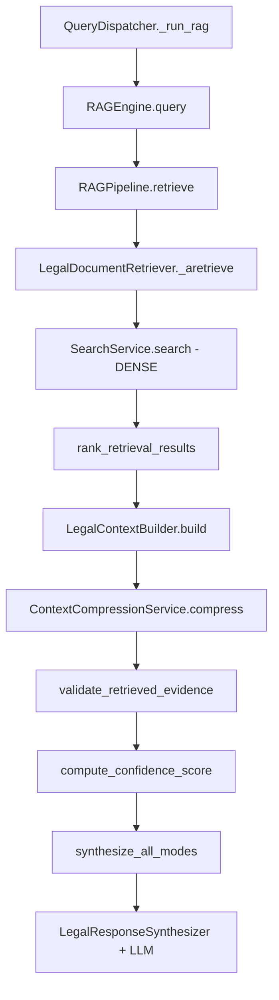
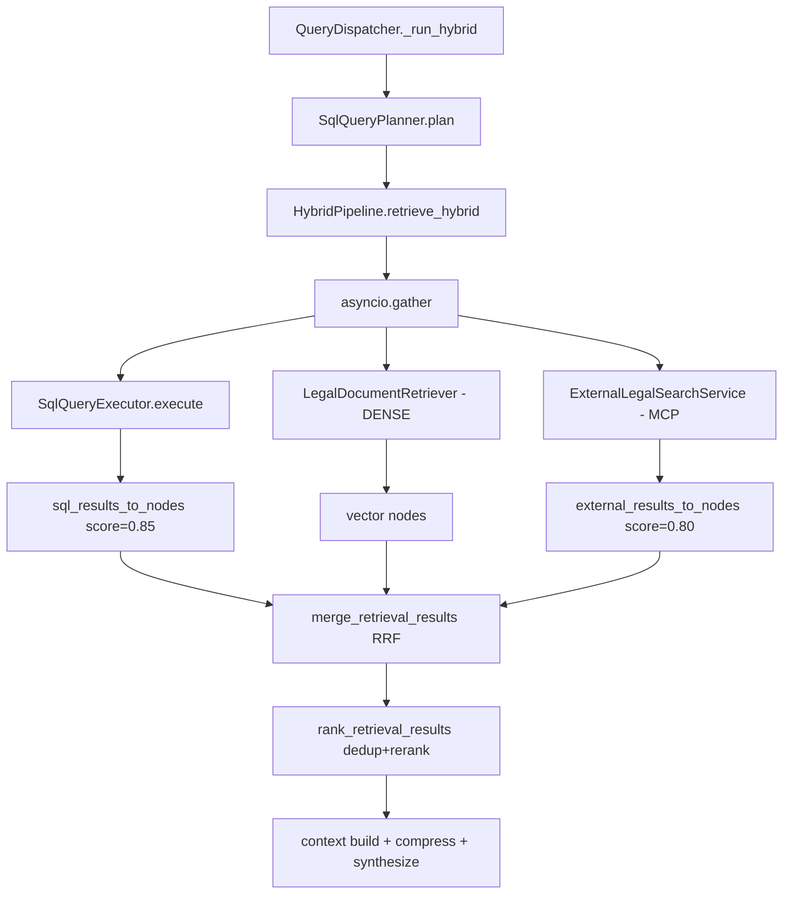
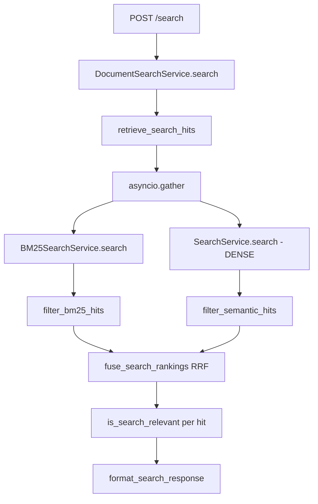

# Retrieval Pipeline Deep Dive

The codebase implements **two independent retrieval systems**. This is critical for evaluation: BM25 exists but is **not** on the `/query` path.

---

## System Comparison

| Path | Entry | Retrieval | Fusion | LLM |
|------|-------|-----------|--------|-----|
| **`POST /query`** | `QueryService` → `QueryDispatcher` | Dense vector; SQL; MCP (hybrid) | RRF on hybrid only | Yes — 3 modes |
| **`POST /search`** | `DocumentSearchService` | BM25 + dense vector | RRF | No |

---

## Answers to Retrieval Questions

### 1. Is dense retrieval implemented?

**Yes.**

- `SearchService.search` embeds query via `EmbeddingService.embed_text`
- `SearchService.search_by_vector` → `_search_pgvector` or `_search_qdrant`
- Similarity: `1 - cosine_distance`
- Wired through `LegalDocumentRetriever._aretrieve` → `RAGPipeline.retrieve`

**Files:** `app/services/search_service.py`, `app/rag/retriever.py`, `app/rag/pipeline.py`

### 2. Is sparse retrieval implemented?

**Yes, on `/search` only.**

- In-memory BM25 via LlamaIndex `BM25Retriever`
- Not used in `RAGPipeline` or `HybridPipeline` vector leg

**Files:** `app/services/bm25_search_service.py`, `app/rag/bm25_retrieval.py`

### 3. Is BM25 implemented?

**Yes — partial scope.**

| Location | Used? |
|----------|-------|
| `POST /search` | Yes — `retrieve_search_hits` |
| `POST /query` RAG | No |
| `POST /query` hybrid | No |

**Dependency:** `llama-index-retrievers-bm25>=0.5.0` in `requirements.txt:31`

### 4. Is PostgreSQL Full Text Search implemented?

**No.**

I could not find evidence of `tsvector`, `to_tsvector`, or `@@` full-text queries in the codebase.

### 5. Is keyword retrieval implemented?

**Yes — two mechanisms:**

1. **BM25** on `/search` (`BM25SearchService`)
2. **Keyword boosts** on `/query` post-retrieval (`rerank_chunks` in `app/rag/ranking.py`) — not a separate retrieval channel

### 6. Is hybrid retrieval implemented?

**Yes — two meanings:**

| Type | Implementation |
|------|----------------|
| **Query hybrid** | SQL + dense vector + optional MCP in parallel (`HybridPipeline.retrieve_hybrid`) |
| **Search hybrid** | BM25 + dense semantic (`app/search/pipeline.py`) |

### 7. Is Reciprocal Rank Fusion implemented?

**Yes.**

```python
# app/utils/rank_fusion.py
scores[key] += 1.0 / (k + rank)  # RRF_K = 60
```

**Callers:**
- `merge_retrieval_results` — vector + SQL + MCP lists
- `fuse_search_rankings` — BM25 + semantic lists

### 8. How are SQL results merged?

1. `SqlQueryExecutor.execute(plan)` → `SqlRetrievalResult`
2. `sql_results_to_nodes` maps contracts, clauses, cases, metadata to `NodeWithScore` at **fixed score 0.85**
3. `merge_retrieval_results(vector_nodes, sql_result, external_nodes?)` fuses via RRF
4. `rank_retrieval_results` deduplicates, merges overlaps, reranks with keyword boosts

**File:** `app/rag/merge.py`, `app/rag/ranking.py`

### 9. How are MCP results merged?

1. `HybridPipeline._search_external` → `ExternalLegalSearchService.search`
2. `external_results_to_nodes` — score from hit or `EXTERNAL_SOURCE_SCORE = 0.80`
3. Third list in `merge_retrieval_results` when `external_nodes` non-empty
4. Same post-merge ranking as SQL

**Files:** `app/rag/hybrid_pipeline.py:131-146`, `app/rag/merge.py:84-129`

### 10. Is score normalization performed?

**Yes — multiple stages:**

| Stage | Mechanism |
|-------|-----------|
| BM25 hits | `raw_score / max_raw_score` → 0–1 (`bm25_search_service._build_hits`) |
| RRF output | Fused RRF scores (typically small); `_normalize_retrieval_score` scales if < 0.15 |
| Semantic | Cosine similarity already 0–1 |
| Search display | `_resolve_scores` clamps to [0, 1] in `search/pipeline.py` |

### 11. How are duplicate chunks removed?

**Three layers:**

1. **RRF fusion** — `node_dedup_key` keeps highest original score per key
2. **Post-RRF pass** — `merge_retrieval_results` skips seen keys
3. **Ranking** — `deduplicate_chunks` (key + Jaccard ≥ 0.85 near-dup) + `merge_overlapping_chunks` (adjacent chunk overlap)

**Dedup key priority** (`node_dedup_key`):
1. `clause:{clause_id}`
2. `chunk:{document_id}:{chunk_index}`
3. `{source_type}:{entity_id}`
4. `content:{sha256(prefix)[:16]}`

### 12. How is the final context assembled?

1. `LegalContextBuilder.build(nodes)` — numbered `[Source N]` blocks + `SourceReference` list
2. `ContextCompressionService.compress` — optional token reduction (`ENABLE_CONTEXT_COMPRESSION`)
3. `internal_source_to_dict` — pipeline-internal source dicts
4. `filter_public_sources` — API-safe source shaping (strips internal fields)

**Files:** `app/rag/context_builder.py`, `app/services/context_compression_service.py`, `app/utils/evidence_validator.py`

### 13. How are retrieval scores calculated?

| Source | Score |
|--------|-------|
| Vector | `1 - cosine_distance` from pgvector/Qdrant |
| SQL nodes | Fixed `0.85` |
| MCP nodes | `hit.score` or `0.80` |
| RRF | `Σ 1/(60 + rank)` per list |
| Final rerank | `semantic + keyword_boost + document_boost` (`rerank_chunks`) |

### 14. How are confidence scores calculated?

**At retrieval (pipeline):**
- `compute_confidence_score(nodes)` — rank-weighted average of node scores
- `_normalize_retrieval_score` for low RRF values

**At response (QueryService):**
- Primary: `analysis_evaluation.confidence` from analysis mode
- Fallback: `compute_confidence_from_evidence` (`app/utils/answer_metrics.py`)
- Override: `_align_metrics_with_evidence` caps at 0.45 when evidence insufficient

**Available but not wired to main path:**
- `compute_confidence()` full multi-signal (`app/rag/confidence.py`) — retrieval 0.35, chunk support 0.15, citation 0.30, LLM 0.20

---

## Complete Retrieval Flow Diagrams

### `/query` — RAG Route



### `/query` — Hybrid Route



### `/search` — BM25 + Semantic



---

## Verification Checklist

| Capability | `/query` | `/search` |
|------------|----------|-----------|
| Dense retrieval | ✅ | ✅ |
| Sparse (BM25) | ❌ | ✅ |
| PostgreSQL FTS | ❌ | ❌ |
| SQL structured | ✅ (sql/hybrid) | ❌ |
| MCP external | ✅ (hybrid) | ❌ |
| RRF | ✅ (hybrid) | ✅ |
| Score normalization | ✅ | ✅ |
| Confidence scoring | ✅ | N/A (no LLM) |

---

## Related Documents

- [03_ARCHITECTURE_ANALYSIS.md](./03_ARCHITECTURE_ANALYSIS.md)
- [06_MEMORY_AND_GUARDRAILS.md](./06_MEMORY_AND_GUARDRAILS.md)
- [10_GAP_ANALYSIS.md](./10_GAP_ANALYSIS.md)
