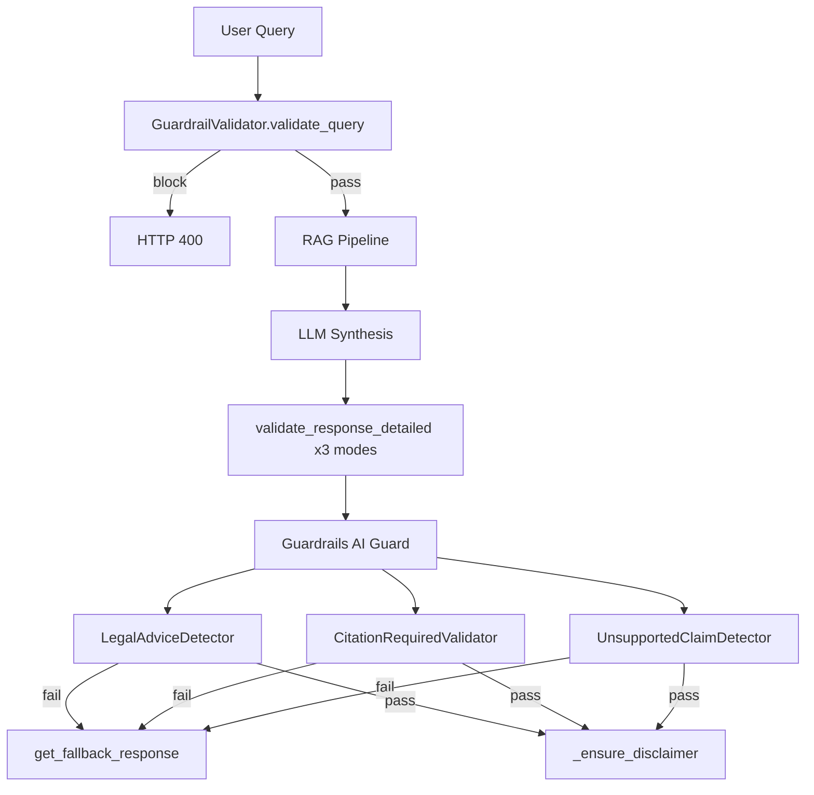

# Memory and Guardrails Analysis

---

# Part 1 — Memory Analysis

## Does Conversational Memory Exist?

**Server-side: No.**  
**Client-side: Yes (ephemeral UI state only).**

---

## session_id

| Location | Usage |
|----------|-------|
| `ChatHistory.session_id` | ORM column — **never written** |
| `Feedback.session_id` | Persisted by `FeedbackService.submit_feedback` |
| `HandoffEscalation.session_id` | Persisted by `HandoffService.process_handoff` |
| `frontend/src/lib/utils.ts` | `getSessionId()` — UUID in `localStorage` key `legaldoc_session_id` |
| `FeedbackPage.tsx` | Sends `session_id` on feedback POST |

**`QueryRequest` does not include `session_id`.** (`app/models/schemas.py:96-123`)

---

## ChatHistory

**ORM:** `app/models/orm.py:429-463`

```python
class ChatHistory(Base, TimestampMixin):
    __tablename__ = "chat_history"
    session_id: Mapped[uuid.UUID]
    role: Mapped[str]  # user/assistant
    message: Mapped[str]
    provider, model, token_count, chat_metadata ...
```

**Migration:** `alembic/versions/001_initial_legal_schema.py`

**Service usage:** I could not find evidence of any INSERT or SELECT against `chat_history` in application code. The table is **schema-only dead code** for the query path.

---

## Conversation Persistence

| Mechanism | Status |
|-----------|--------|
| Database `chat_history` | Schema exists; unused |
| `QueryService.ask` persistence | Not implemented |
| Client `ChatPage` React state | In-memory only; lost on refresh |
| `HandoffRequest.conversation_history` | Client must POST explicitly; no frontend wiring found |

---

## Previous Message Retrieval

**Not implemented.** Each `/query` call sends only the current `question` with no prior turns injected into the LLM prompt.

---

## Context Reconstruction

**Retrieval context only** — `LegalContextBuilder` builds context from **retrieved document chunks**, not from prior chat turns.

`PromptManager.build_synthesis_messages` receives `context` (retrieved) + `question` — no `chat_history` parameter.

---

## LlamaIndex Memory

I could not find evidence of:
- `ChatMemoryBuffer`
- `ChatSummaryMemory`
- Any LlamaIndex memory module in `app/`

---

## Memory Buffers

**Context compression** (`ContextCompressionService`) enforces a **token budget on retrieved chunks**, not conversational memory.

---

## What Is Missing

1. `session_id` on `QueryRequest` / `QueryResponse`
2. Service to append user/assistant turns to `ChatHistory`
3. Service to load last N turns by `session_id`
4. Prompt assembly including conversation history
5. Optional summarization of old turns
6. Frontend passing `session_id` on query (currently only on feedback)

---

# Part 2 — Guardrails Analysis

## Architecture



**Orchestrator:** `GuardrailValidator` (`app/guardrails/validator.py`)  
**Guard composition:** `create_legal_guard()` (`app/guardrails/guard.py`)

---

## Input Validation

**Method:** `GuardrailValidator.validate_query`

| Check | Implementation |
|-------|----------------|
| Feature flag | Skips if `ENABLE_GUARDRAILS=false` |
| Length | `len(query) > MAX_QUERY_LENGTH` → `GuardrailViolationError` |
| Injection phrases | Substring match: `"ignore previous instructions"`, `"disregard all rules"` |

**Raises:** `GuardrailViolationError` → HTTP 400 via exception handler

**Gap:** No Pydantic-level semantic validation beyond length; no ML-based injection detection.

---

## Prompt Injection Protection

**Basic substring blocklist only** — see `BLOCKED_PATTERNS` in `validator.py:29-32`.

Not a comprehensive prompt injection framework.

---

## Output Validation

**Method:** `validate_response_detailed` → `self._guard.validate(response, metadata=...)`

Metadata passed to validators:
- `sources` — list of source dicts with excerpts
- `question` — original query
- `response_mode` — `strict`, `explain`, or `analysis`

**Blocking validators** (`BLOCKING_VALIDATOR_NAMES`):
- `LegalAdviceDetector`
- `CitationRequiredValidator`
- `UnsupportedClaimDetector`

Non-blocking: `DisclaimerValidator` exists but is **not** in the guard pipeline.

---

## Citation Validation

**Validator:** `CitationRequiredValidator` (`app/guardrails/validators/citation_required.py`)

| Rule | Behavior |
|------|----------|
| Insufficient-info responses | Skipped |
| Empty sources | Skipped |
| Substantive answers (≥80 chars or claim indicators) | Requires citation regex |
| Strict mode | Always requires `[Source N]` when sources exist |

**Patterns:** `CITATION_PATTERNS` in `app/guardrails/constants.py`

---

## Unsupported Claim Detection

**Validator:** `UnsupportedClaimDetector` (`app/guardrails/validators/unsupported_claims.py`)

**Method:**
1. Build corpus from `metadata["sources"]` excerpts (`_source_corpus`)
2. Extract claim tokens via regex: dates, money (`$`), percentages, proper nouns
3. Check each token appears in corpus (`_token_in_corpus`)
4. Percent variants: digit % → word forms (e.g., `25%` → `twenty-five percent`)
5. Explain-mode calculation lines get carve-out (`_is_explain_mode_scenario_answer`)

**Weakness:** Brittle exact/substring matching — formatting differences cause false positives.

---

## Fallback Logic

**File:** `app/guardrails/fallbacks.py` — `get_fallback_response(validator_name, has_sources)`

Called when any blocking validator fails. Returns safe canned responses per violation type.

**Disclaimer:** Always appended via `_ensure_disclaimer` even when guardrails disabled.

---

## Hallucination Prevention

**Multi-layer (not single validator):**

| Layer | Mechanism |
|-------|-----------|
| Prompts | "Answer ONLY from context" in mode prompts |
| Retrieval gating | `validate_retrieved_evidence` — insufficient evidence → low metrics |
| `UnsupportedClaimDetector` | Regex fact grounding |
| `CitationRequiredValidator` | Requires source citations |
| `LegalAdviceDetector` | Blocks prescriptive legal advice without citations |
| Strict mode evidence | `evidence_validator` + `EVIDENCE_NONE_FOUND_RESPONSE` patterns |
| Metrics cap | `_align_metrics_with_evidence` reduces confidence when weak |

---

## Every Validator Individually

### 1. LegalAdviceDetector

| Field | Value |
|-------|-------|
| **File** | `app/guardrails/validators/legal_advice.py` |
| **Registered** | `legal/advice-detector` |
| **Logic** | Regex `LEGAL_ADVICE_PATTERNS`; fails if prescriptive language without sources/citations |
| **In guard** | Yes (`on_fail="refrain"`) |

### 2. CitationRequiredValidator

| Field | Value |
|-------|-------|
| **File** | `app/guardrails/validators/citation_required.py` |
| **Registered** | `legal/citation-required` |
| **Logic** | Citation regex required for substantive answers; strict mode always requires citations |
| **In guard** | Yes |

### 3. UnsupportedClaimDetector

| Field | Value |
|-------|-------|
| **File** | `app/guardrails/validators/unsupported_claims.py` |
| **Registered** | `legal/unsupported-claims` |
| **Logic** | Regex extract dates/money/percents/names; verify in source corpus |
| **In guard** | Yes |

### 4. DisclaimerValidator

| Field | Value |
|-------|-------|
| **File** | `app/guardrails/validators/disclaimer.py` |
| **Registered** | `legal/disclaimer` |
| **Logic** | Fails if `LEGAL_DISCLAIMER` missing |
| **In guard** | **No** — disclaimer enforced by `_ensure_disclaimer()` instead |

---

## Related: Evidence Validator (Not Guardrails)

**File:** `app/utils/evidence_validator.py`

| Function | Role |
|----------|------|
| `validate_retrieved_evidence` | Checks if sources support the question |
| `has_sufficient_evidence` | Boolean gate |
| `filter_public_sources` | API response shaping |

Used in `QueryService._align_metrics_with_evidence` — affects metrics, not blocking.

---

## Configuration

| Setting | Default | File |
|---------|---------|------|
| `ENABLE_GUARDRAILS` | `true` | `app/core/config.py` |
| `MAX_QUERY_LENGTH` | config | `app/core/config.py` |
| `GUARDRAILS_RUN_SYNC` | `true` | `app/core/config.py` |

---

## Tests

`tests/test_guardrails.py` — covers all validators and query validation.

---

## Related Documents

- [04_FEATURE_MAPPING.md](./04_FEATURE_MAPPING.md)
- [07_OBSERVABILITY_AND_DEPLOYMENT.md](./07_OBSERVABILITY_AND_DEPLOYMENT.md)
