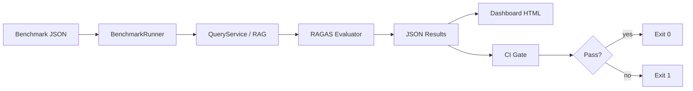

# Observability and Deployment

---

## Logging

| Component | File | Details |
|-----------|------|---------|
| Setup | `app/core/logging.py` | `setup_logging()` — stdlib `logging.basicConfig` |
| Format | Plain text | `%(asctime)s \| %(levelname)-8s \| %(name)s \| %(message)s` |
| Level | `LOG_LEVEL` from settings | Default INFO |
| HTTP debug | `_HTTP_DEBUG_LOGGERS` | httpx, groq, openai, llama_index at DEBUG |
| Request logging | `app/core/middleware.py` | `RequestLoggingMiddleware` — method, path, status, latency_ms |
| Startup | `app/main.py:lifespan` | App name, DB target, Qdrant init |
| Per-module | Throughout `app/` | `logger = logging.getLogger(__name__)` |

### structlog

**Status: Dependency present, not used.**

- Listed in `requirements.txt:56` and `pyproject.toml`
- `setup_logging()` does **not** configure structlog
- All logs are plain strings — not JSON structured

---

## Langfuse

| Component | File |
|-----------|------|
| Client | `app/evaluation/tracing.py` — `get_langfuse_client()` |
| Trace wrapper | `trace_query()` — context manager per query |
| Result logging | `log_query_result()` — answer, sources, confidence, route, latency, cost |
| Eval scores | `log_evaluation_scores()` — RAGAS metrics |
| Flush | `flush_traces()` on shutdown |

**Integration point:** `QueryService.ask()` when `ENABLE_LANGFUSE=true`

**Default:** `ENABLE_LANGFUSE: bool = False` in `app/core/config.py`

**Config vars:** `LANGFUSE_PUBLIC_KEY`, `LANGFUSE_SECRET_KEY`, `LANGFUSE_HOST`

**Not used for:** Prompt registry, feature flags, or A/B testing.

---

## Tracing

- Langfuse chain observations per `/query` request (when enabled)
- No OpenTelemetry or distributed tracing elsewhere
- MCP client has timeout but no trace propagation

---

## Metrics

### Runtime / Operational Metrics

| Metric | Available? | Where |
|--------|------------|-------|
| Request latency | Yes | `QueryResponse.latency_ms`; middleware logs |
| Retrieval counts | Yes | `QueryResponse` routing metadata, source counts |
| Faithfulness/relevance/confidence | Yes | `QueryResponse` fields |
| Error rates | Partial | Exception handlers log warnings/errors |
| CPU/memory | No | — |
| DB pool occupancy | No | — |
| Active request gauge | No | — |

### Prometheus

**Does Prometheus exist? No.**

I could not find evidence of:
- `prometheus_client` dependency
- `/metrics` endpoint
- Counter/Histogram instrumentation

---

## Cost Tracking

| Component | File |
|-----------|------|
| Estimation | `app/evaluation/cost.py` — `estimate_cost()` |
| Token counting | `app/utils/tokens.py` — `count_tokens()` via tiktoken |
| Pricing table | `PRICING` dict — gpt-4o-mini, gpt-4o, embedding models |

**When logged:**
- `QueryService.ask` → Langfuse when `ENABLE_LANGFUSE=true`
- `BenchmarkRunner` during offline evaluation

**Not exposed:** Live API does not return `cost_usd` in `QueryResponse`.

### Budget Limits

**Not implemented.** No daily/monthly spend tracking, no HTTP 429 on limit exceed.

---

## Benchmarking

| Artifact | Purpose |
|----------|---------|
| `app/evaluation/runner.py` | `BenchmarkRunner.run_dataset()` |
| `app/evaluation/metrics.py` | `RAGEvaluator.compute_ragas_scores()` |
| `app/evaluation/dataset.py` | `load_benchmark()` |
| `scripts/run_benchmark.py` | CLI benchmark execution |
| `scripts/ci_benchmark_gate.py` | CI quality gates |
| `app/evaluation/dashboard.py` | HTML dashboard from JSON results |
| `eval_navigator_langfuse.py` | External eval against live API |

**CI thresholds** (`ci_benchmark_gate.py`):
- context_precision ≥ 0.6
- context_recall ≥ 0.6
- faithfulness ≥ 0.7
- answer_relevancy ≥ 0.7
- avg_latency_ms ≤ `EVAL_LATENCY_THRESHOLD_MS`
- total_cost_usd ≤ `EVAL_COST_THRESHOLD_USD`

---

## Evaluation Pipeline



**Deterministic metrics** (no LLM): `MetricsEvaluator` (`app/utils/metrics_evaluator.py`), `answer_metrics.py`

**Structured analysis eval:** `AnalysisEvaluation` model parsed from analysis mode output

---

## Health Checks

### `GET /health`

**File:** `app/api/health.py`

Returns static:
```json
{"status": "healthy", "app_name": "...", "version": "0.1.0"}
```

**Does not check:** PostgreSQL, Qdrant, LLM connectivity, embedding service, disk space.

### Startup Checks (not health endpoint)

**File:** `app/main.py:lifespan`

| Check | When |
|-------|------|
| `verify_database_connection()` | `SELECT 1` on startup |
| `QdrantVectorService.ensure_collection()` | If `VECTOR_BACKEND=qdrant` |
| `log_llm_configuration()` | Logs resolved providers |

**Render:** `render.yaml` uses `healthCheckPath: /health` — shallow liveness only.

---

## Runtime Monitoring

| Capability | Status |
|------------|--------|
| Prometheus | Missing |
| Grafana | Missing |
| Sentry | Missing |
| APM (Datadog, etc.) | Missing |
| Structured JSON logs | Missing |
| Langfuse live dashboard | Optional (disabled by default) |

**Per-request observability:** Middleware latency log + `QueryResponse.latency_ms` + optional Langfuse trace.

---

## Deployment

### Docker

**`Dockerfile`:**
- Python 3.12-slim
- `build-essential`, `libpq-dev`
- CMD: `alembic upgrade head && uvicorn app.main:app`

**Missing in image:** Tesseract OCR, frontend

**`docker-compose.yml`:**
- `api` service (port 8000)
- `postgres` (pgvector/pgvector:pg16)
- Volume: `./data/uploads`
- No Qdrant, Redis, or frontend services

### Render

**`render.yaml`:**
- Web service `c3-legaldoc-navigator-api`
- Production: `VECTOR_BACKEND=qdrant`, `STORAGE_BACKEND=s3`
- `ENABLE_LANGFUSE=false`, `ENABLE_GUARDRAILS=true`
- External DB/Qdrant/S3 via env vars (`sync: false`)

### Frontend

- Vite React app in `frontend/`
- Dev proxy to API (`frontend/vite.config.ts`)
- **No Dockerfile or render service** for frontend in repo

### Database Migrations

- Alembic auto-run on container start
- Versions: `001`–`006` including `chunk_text` backfill

---

## Environment Variables (Observability-Related)

| Variable | Purpose |
|----------|---------|
| `LOG_LEVEL` | Logging verbosity |
| `ENABLE_LANGFUSE` | Toggle tracing |
| `LANGFUSE_PUBLIC_KEY` | Langfuse auth |
| `LANGFUSE_SECRET_KEY` | Langfuse auth |
| `LANGFUSE_HOST` | Langfuse endpoint |
| `EVAL_BENCHMARK_PATH` | Benchmark dataset path |
| `EVAL_OUTPUT_DIR` | Results output |
| `EVAL_LATENCY_THRESHOLD_MS` | CI latency gate |
| `EVAL_COST_THRESHOLD_USD` | CI cost gate |

---

## Summary

| Question | Answer |
|----------|--------|
| **Does Prometheus exist?** | **No** |
| **Do runtime metrics exist?** | **Partially** — per-request latency and quality scores in API response; no infrastructure metrics |
| **Is Langfuse active by default?** | **No** — `ENABLE_LANGFUSE=false` |
| **Is cost tracked at runtime?** | **Yes when Langfuse enabled** — not in API response |
| **Are budget limits enforced?** | **No** |
| **Is health check production-grade?** | **No** — static liveness only |

---

## Related Documents

- [10_GAP_ANALYSIS.md](./10_GAP_ANALYSIS.md)
- [11_IMPLEMENTATION_ROADMAP.md](./11_IMPLEMENTATION_ROADMAP.md)
