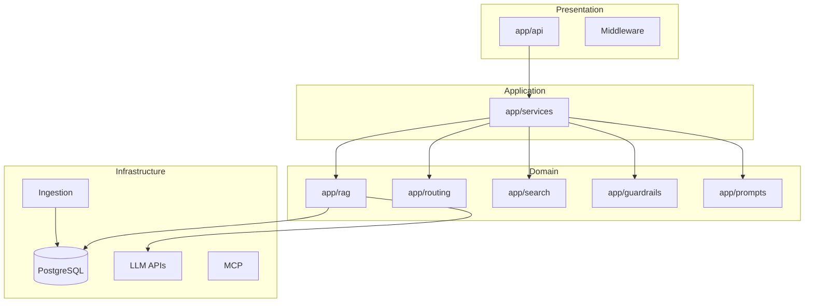

# C3 LegalDoc Navigator — Project Technical Audit Report

**Audit Date:** July 7, 2026  
**Auditor Method:** Full codebase reverse-engineering with independent verification of `evaluation_report.md`  
**Codebase Path:** `g:\C3\Projects\demo1\c3-legaldoc-navigator`  
**No source code was modified during this audit.**

---

## Table of Contents

1. [Executive Summary](#executive-summary)
2. [Evaluation Report Verification](#evaluation-report-verification)
3. [Architecture Analysis](#architecture-analysis)
4. [Complete Feature Inventory](#complete-feature-inventory)
5. [Retrieval Pipeline Analysis](#retrieval-pipeline-analysis)
6. [Memory Analysis](#memory-analysis)
7. [Guardrails Analysis](#guardrails-analysis)
8. [Observability](#observability)
9. [File Reference Guide](#file-reference-guide)
10. [Dependency Map](#dependency-map)
11. [Technical Debt](#technical-debt)
12. [Gap Analysis](#gap-analysis)
13. [Implementation Roadmap](#implementation-roadmap)
14. [Appendix](#appendix)

**Detailed section documents:**
- [01_EXECUTIVE_SUMMARY.md](./01_EXECUTIVE_SUMMARY.md)
- [02_EVALUATION_REPORT_VERIFICATION.md](./02_EVALUATION_REPORT_VERIFICATION.md)
- [03_ARCHITECTURE_ANALYSIS.md](./03_ARCHITECTURE_ANALYSIS.md)
- [04_FEATURE_MAPPING.md](./04_FEATURE_MAPPING.md)
- [05_RETRIEVAL_PIPELINE_ANALYSIS.md](./05_RETRIEVAL_PIPELINE_ANALYSIS.md)
- [06_MEMORY_AND_GUARDRAILS.md](./06_MEMORY_AND_GUARDRAILS.md)
- [07_OBSERVABILITY_AND_DEPLOYMENT.md](./07_OBSERVABILITY_AND_DEPLOYMENT.md)
- [08_FILE_REFERENCE_GUIDE.md](./08_FILE_REFERENCE_GUIDE.md)
- [09_DEPENDENCY_MAP.md](./09_DEPENDENCY_MAP.md)
- [10_GAP_ANALYSIS.md](./10_GAP_ANALYSIS.md)
- [11_IMPLEMENTATION_ROADMAP.md](./11_IMPLEMENTATION_ROADMAP.md)

---

## Executive Summary

### High-Level Project Overview

C3 LegalDoc Navigator is an AI legal document assistant. Users upload legal files (PDF, DOCX, TXT); the backend parses, chunks, embeds, and indexes content. Natural-language questions receive grounded answers with citations across three response modes: **strict**, **explain**, and **analysis**.

The system supports intelligent query routing to:
- **RAG** — dense vector retrieval (pgvector or Qdrant)
- **SQL** — structured metadata retrieval
- **Hybrid** — parallel vector + SQL + optional MCP external legal databases, fused with Reciprocal Rank Fusion (RRF)

A **second API** (`POST /search`) provides hybrid **BM25 + semantic** evidence search without LLM synthesis — a significant addition since the original evaluation report was written.

### Architecture Summary

Layered FastAPI application with manual dependency injection (`app/dependencies.py`), SQLAlchemy async ORM, LlamaIndex-based retrieval nodes, and Guardrails AI post-response validation.

### Technology Stack

FastAPI · PostgreSQL 16 + pgvector · Qdrant (optional) · LlamaIndex · OpenAI/Anthropic/Gemini/Groq/Azure LLMs · Guardrails AI · Langfuse (optional) · RAGAS · React/Vite frontend

### Project Strengths

- Multi-route retrieval with parallel hybrid execution and RRF merge
- BM25 + semantic search on `/search` with tests and frontend evidence UI
- Three-mode LLM responses with structured `AnalysisEvaluation`
- Guardrails pipeline with fallbacks
- Offline RAGAS benchmarks with CI quality gates
- Rich configuration for multi-provider LLM, storage backends, MCP

### Project Weaknesses

- **No server-side conversational memory** (`ChatHistory` unused)
- **BM25 not on `/query`** — main Q&A path remains dense-only
- No budget enforcement, Prometheus, or load testing artifacts
- Shallow `/health` endpoint
- No API authentication
- OCR not containerized

### Overall Technical Maturity

**Good** — production-capable RAG prototype with operational and memory gaps.

### Overall Assessment of Evaluation Report

The evaluation report is **largely accurate** but **outdated on BM25**: sparse retrieval exists on `/search` but not integrated into `/query`. The report correctly identifies memory, observability, budget, and load testing gaps.

---

## Evaluation Report Verification

See full matrix: [02_EVALUATION_REPORT_VERIFICATION.md](./02_EVALUATION_REPORT_VERIFICATION.md)

### Summary Table

| Criterion | Report Status | Verified Verdict |
|-----------|---------------|------------------|
| 1. Architecture | Strong | **Correct** — minor pooling nuance |
| 2. Prompting | Strong | **Correct** |
| 3. FastAPI Endpoints | Good | **Correct** — `/search` not in original report |
| 4. Memory | Critical Failure | **Correct** |
| 5. RAG + SQL + Hybrid | Strong | **Correct** |
| 6. Guardrails | Good | **Correct** |
| 7. Observability | Good | **Correct** — no Prometheus |
| 8. Cost/Budget | Partially Met | **Correct** |
| 9. Load Testing | Missing | **Correct** |
| 10. Performance | Good | **Correct** — IVFFlat, no Redis |
| 11. Deployment | Strong | **Mostly Correct** |
| 12. SLO Bound | Partially Met | **Correct** |
| 13. Hybrid Retrieval | Strong | **Partially Correct** — BM25 on `/search` only |

### Key Correction to Evaluation Report

| Report Claim | Actual | Verdict |
|--------------|--------|---------|
| "No BM25 or sparse keyword search" | BM25 + semantic RRF on `POST /search` | **Partially Correct / Outdated** |
| "No dense-sparse hybrid for RAG" | True for `/query`; false for `/search` | **Partially Correct** |

---

## Architecture Analysis

See: [03_ARCHITECTURE_ANALYSIS.md](./03_ARCHITECTURE_ANALYSIS.md)

### Layered Architecture



### Request Lifecycle (`POST /query`)

1. FastAPI validates `QueryRequest`
2. `GuardrailValidator.validate_query()` — length, injection phrases
3. Langfuse trace (optional)
4. `QueryDispatcher.dispatch()` — route via `Router` or force RAG if `document_id`
5. Pipeline retrieve → rank → context → compress → evidence validate
6. `LegalResponseSynthesizer` — strict/explain/analysis modes
7. Guardrails on all three mode answers
8. Metrics alignment with evidence
9. `build_query_response()` → JSON

### Dependency Injection

`app/dependencies.py` — `@lru_cache` singletons + per-request `Depends(get_db)`.

### Configuration

`app/core/config.py` — Pydantic Settings with import-time validators.

---

## Complete Feature Inventory

See: [04_FEATURE_MAPPING.md](./04_FEATURE_MAPPING.md)

| Feature | Status |
|---------|--------|
| Document Upload | Fully Implemented |
| OCR | Partially Implemented |
| PDF Parsing | Fully Implemented |
| Chunking | Fully Implemented |
| Embedding Generation/Storage | Fully Implemented |
| pgvector | Fully Implemented |
| Query Routing | Fully Implemented |
| RAG (/query) | Fully Implemented |
| Vector Retrieval | Fully Implemented |
| SQL Retrieval | Fully Implemented |
| Hybrid Retrieval (/query) | Fully Implemented |
| MCP Retrieval | Fully Implemented (when enabled) |
| BM25 | **Partially** — `/search` only |
| RRF | Fully Implemented |
| Prompt Manager / Modes | Fully Implemented |
| Guardrails | Fully Implemented |
| Cost Tracking | Partially Implemented |
| Budget Limits | **Missing** |
| Langfuse | Partially Implemented |
| Evaluation/Benchmarking | Fully Implemented |
| Health Endpoint | Partially Implemented |
| Docker/Deploy | Fully Implemented |
| Authentication | **Missing** |
| Chat History / Memory | **Missing** (server) |
| Load Testing | **Missing** |
| Caching (Redis) | **Missing** |
| Background Jobs | **Missing** |

---

## Retrieval Pipeline Analysis

See: [05_RETRIEVAL_PIPELINE_ANALYSIS.md](./05_RETRIEVAL_PIPELINE_ANALYSIS.md)

### Verified Capabilities

| Capability | `/query` | `/search` |
|------------|----------|-----------|
| Dense Retrieval | ✅ | ✅ |
| Sparse (BM25) | ❌ | ✅ |
| PostgreSQL FTS | ❌ | ❌ |
| Hybrid (multi-source) | ✅ SQL+vector+MCP | ✅ BM25+semantic |
| RRF | ✅ hybrid route | ✅ |
| Score Normalization | ✅ | ✅ |
| Confidence Scoring | ✅ | N/A |

### Query Routing

`Router.route()` → `rag` | `sql` | `hybrid` via LLM JSON classification.

### Fusion

- **Hybrid query:** `merge_retrieval_results` — RRF over vector + SQL (0.85) + MCP (0.80)
- **Search:** `fuse_search_rankings` — RRF over BM25 + semantic

### Deduplication

`node_dedup_key` → RRF dedup → `deduplicate_chunks` (Jaccard) → `merge_overlapping_chunks`

### Context Assembly

`LegalContextBuilder` → `ContextCompressionService` → LLM prompt

---

## Memory Analysis

See: [06_MEMORY_AND_GUARDRAILS.md](./06_MEMORY_AND_GUARDRAILS.md)

### Findings

| Component | Status |
|-----------|--------|
| `session_id` on query | **Missing** |
| `ChatHistory` ORM | Exists, **unused** |
| Conversation persistence | **Missing** (server) |
| Previous context loading | **Missing** |
| LlamaIndex memory buffers | **Not found** |
| Client chat state | React `useState` in `ChatPage.tsx` only |

**Conclusion:** Multi-turn conversation is a **critical gap** confirmed by code inspection.

---

## Guardrails Analysis

See: [06_MEMORY_AND_GUARDRAILS.md](./06_MEMORY_AND_GUARDRAILS.md)

| Validator | In Guard Pipeline | Purpose |
|-----------|-------------------|---------|
| `LegalAdviceDetector` | Yes | Block prescriptive advice without citations |
| `CitationRequiredValidator` | Yes | Require `[Source N]` citations |
| `UnsupportedClaimDetector` | Yes | Regex fact grounding |
| `DisclaimerValidator` | **No** | Disclaimer via `_ensure_disclaimer()` instead |

**Input validation:** length + substring injection blocklist  
**Output validation:** Guardrails AI guard with `on_fail="refrain"`  
**Fallback:** `get_fallback_response()` per violation type

---

## Observability

See: [07_OBSERVABILITY_AND_DEPLOYMENT.md](./07_OBSERVABILITY_AND_DEPLOYMENT.md)

| Component | Status |
|-----------|--------|
| Logging | Stdlib basicConfig |
| structlog | Dependency only — **unused** |
| Langfuse | Optional (`ENABLE_LANGFUSE=false`) |
| Cost tracking | `estimate_cost()` → Langfuse when enabled |
| Prometheus | **Does not exist** |
| Runtime metrics | Partial — `latency_ms` in API response |
| Health checks | Static `/health` |
| Benchmarking | RAGAS + CI gates |
| Load testing | **Missing** |

---

## File Reference Guide

See: [08_FILE_REFERENCE_GUIDE.md](./08_FILE_REFERENCE_GUIDE.md)

**Critical entry points:**
- `app/main.py` — application bootstrap
- `app/api/query.py` — Q&A endpoint
- `app/api/keyword_search.py` — BM25+semantic search
- `app/services/query_service.py` — query orchestration
- `app/rag/pipeline.py` / `hybrid_pipeline.py` — retrieval
- `app/search/pipeline.py` — independent search fusion
- `app/guardrails/validator.py` — safety boundary

---

## Dependency Map

See: [09_DEPENDENCY_MAP.md](./09_DEPENDENCY_MAP.md)

### Dead / Unused Code

- `ChatHistory` — schema only
- `DisclaimerValidator` — not in guard pipeline
- `compute_confidence()` — not wired to main path
- `fusion_search_service.py` — staged in git, **not on disk**

### Critical Files

`config.py`, `session.py`, `query_service.py`, `merge.py`, `validator.py`, `schemas.py`, `dependencies.py`

---

## Technical Debt

| Severity | Items |
|----------|-------|
| **Critical** | No server memory; no API auth |
| **High** | BM25 not in `/query`; no budget limits; no Prometheus; shallow health |
| **Medium** | IVFFlat indexes; sync guardrails; dual search architectures; unused ChatHistory |
| **Low** | Unused structlog; unused API_V1_PREFIX; legacy templates.py |

---

## Gap Analysis

See: [10_GAP_ANALYSIS.md](./10_GAP_ANALYSIS.md)

### Highest-Impact Gaps

1. Server-side conversational memory
2. BM25 integration into `/query`
3. Budget enforcement
4. Operational metrics (Prometheus)
5. Load testing artifacts

### Implemented but Overlooked

- `POST /search` BM25 + semantic hybrid
- Evidence validator + metric alignment
- Analysis mode structured evaluation
- MCP external search on hybrid route
- Context compression

---

## Implementation Roadmap

See: [11_IMPLEMENTATION_ROADMAP.md](./11_IMPLEMENTATION_ROADMAP.md)

### Phase 1 — Critical for Evaluation Marks

| Priority | Item | Effort | Impact |
|----------|------|--------|--------|
| 1 | Locust load tests | 1 day | High |
| 2 | Deep `/health` | 0.5–1 day | Medium |
| 3 | structlog JSON | 0.5–1 day | Medium |
| 4 | BM25 in `/query` | 2–4 days | Very High |
| 5 | Chat memory | 3–5 days | Critical |
| 6 | Budget limits | 2–3 days | High |
| 7 | Prometheus `/metrics` | 2–3 days | High |

### Phase 2 — Recommended

Rate limiting, Redis cache, semantic guardrails, HNSW migration, Tesseract in Docker

### Phase 3 — Future

PostgreSQL FTS, Langfuse prompt registry, full OAuth, Kubernetes

### ROI Ranking

Locust → Health → structlog → BM25 in query → Memory → Budget → Prometheus

---

## Appendix

### Project Directory Overview

```
c3-legaldoc-navigator/
├── app/                    # FastAPI backend
│   ├── api/                # HTTP endpoints
│   ├── core/               # Config, logging, middleware
│   ├── database/           # SQLAlchemy session
│   ├── evaluation/         # Langfuse, RAGAS, cost
│   ├── guardrails/         # Safety validators
│   ├── ingestion/          # Parse, chunk, OCR
│   ├── mcp/                # External legal DB search
│   ├── models/             # ORM + Pydantic schemas
│   ├── prompts/            # Mode prompts + manager
│   ├── rag/                # RAG/hybrid pipelines
│   ├── routing/            # Query classifier
│   ├── search/             # /search BM25+semantic
│   ├── services/           # Business logic
│   └── utils/              # Shared utilities
├── alembic/                # DB migrations
├── frontend/               # React UI
├── scripts/                # Benchmarks, SQL, CI gates
├── tests/                  # Pytest suite
├── docs/project_audit/     # This audit (12 documents)
├── docker-compose.yml
├── Dockerfile
├── render.yaml
└── evaluation_report.md    # External assessment (verified)
```

### API Endpoint Summary

| Method | Path | Purpose |
|--------|------|---------|
| GET | `/health` | Liveness |
| POST | `/upload` | Document ingest |
| POST | `/query` | RAG Q&A (3 modes) |
| POST | `/search` | BM25 + semantic evidence |
| GET | `/documents` | List documents |
| GET | `/document/{id}` | Document detail |
| POST | `/feedback` | User feedback |
| POST | `/handoff` | Human escalation |

### Database Schema Summary

| Table | Populated by Upload? |
|-------|---------------------|
| `documents` | Yes |
| `document_embeddings` | Yes |
| `feedback` | Via API |
| `handoff_escalations` | Via API |
| `chat_history` | **No** |
| `clauses` | **No** |
| `cases` | **No** (SQL route only) |
| `statutes` | **No** (SQL route only) |
| `users` | **No** |

### Configuration Files

| File | Purpose |
|------|---------|
| `.env` / `.env.example` | Runtime secrets |
| `app/core/config.py` | Pydantic settings |
| `alembic.ini` | Migration config |
| `render.yaml` | Cloud deploy |
| `docker-compose.yml` | Local stack |

### Key Environment Variables

`DATABASE_URL`, `VECTOR_BACKEND`, `EMBEDDING_PROVIDER`, `DEFAULT_LLM_PROVIDER`, `ENABLE_GUARDRAILS`, `ENABLE_LANGFUSE`, `MCP_ENABLED`, `CHUNK_SIZE`, `TOP_K_RETRIEVAL`, `BM25_DEFAULT_TOP_K`, `SEARCH_SEMANTIC_THRESHOLD`

### External Services

PostgreSQL · LLM providers · Embedding APIs · Qdrant (optional) · S3/Supabase storage · MCP legal servers (optional) · Langfuse (optional) · Tesseract binary (OCR)

### Third-Party Libraries (Key)

`fastapi`, `sqlalchemy`, `asyncpg`, `pgvector`, `llama-index`, `llama-index-retrievers-bm25`, `guardrails-ai`, `mcp`, `langfuse`, `ragas`, `tiktoken`, `pymupdf`, `pytesseract`

### Important Startup Files

| File | Role |
|------|------|
| `app/main.py` | Uvicorn entry, lifespan |
| `app/database/session.py` | Engine + `get_db` |
| `app/dependencies.py` | DI graph |
| `Dockerfile` | `alembic upgrade head && uvicorn` |

---

*End of Project Technical Audit Report*

*Generated by independent codebase analysis. All conclusions reference verifiable source files. Where evidence was absent, findings state: "I could not find evidence of this implementation."*
