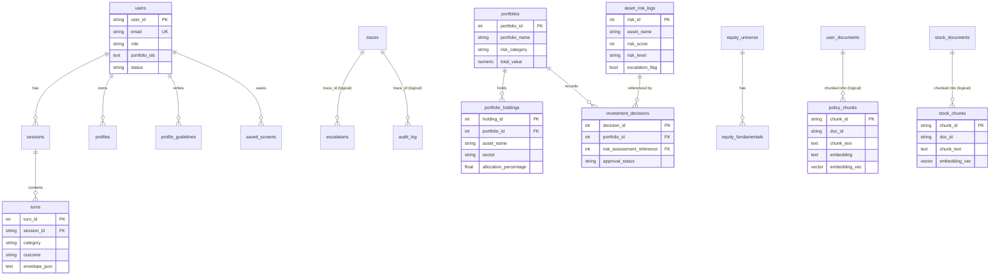

# Current Database Architecture

**System:** Finance Risk & Investment Intelligence System (FRIIS)
**Source of truth:** `capstone/app/models.py` (ORM), `capstone/app/core/db.py` (engines, schema bootstrap), `capstone/app/sqlq/` (templates, executor, seed).
Column-by-column detail lives in `DATABASE_TABLE_REFERENCE.md`; this document covers design.

---

## 1. Database technology

| Item | Value |
|---|---|
| Engine | PostgreSQL 16 (Render free tier in cloud, local Postgres on `:5432`) |
| Vector extension | `pgvector` (`CREATE EXTENSION IF NOT EXISTS vector`) |
| Driver | `psycopg[binary]` 3.2 via SQLAlchemy 2.0 (`postgresql+psycopg://`) |
| ORM style | SQLAlchemy declarative, three separate `DeclarativeBase` classes |
| Schema management | `Base.metadata.create_all()` at startup + idempotent `ADD COLUMN IF NOT EXISTS` upgrades (no Alembic) |
| Test fallback | SQLite (engines accept `sqlite://`; pgvector path is skipped and cosine runs in Python) |

---

## 2. Three logical databases

The system separates identity, finance data and ticker filings into three databases, each with its own engine and session factory.

| Base class | Env var | Local default | Purpose |
|---|---|---|---|
| `AuthBase` | `AUTH_DATABASE_URL` | `finance_auth_db` | identity, sessions, memory, audit, traces, escalations |
| `FinanceBase` | `DATABASE_URL` | `finance_risk_db` | synthetic finance tables, house policy corpus, equities |
| `StockBase` | `STOCK_DATABASE_URL` | `finance_stock_db` | per-ticker filings and chunks |

**Why separate:** the query path reads finance data **read-only through named templates**, while writes to identity/audit happen in a different database. A SQL bug in finance templates cannot touch password hashes. On Render all three variables point to **one** Postgres instance because no table names collide.

---

## 3. Tables (21)

| Database | Table | Domain | Rows at seed |
|---|---|---|---|
| auth | `users` | Identity | 25 |
| auth | `sessions` | Conversation | – |
| auth | `turns` | Conversation / memory | – |
| auth | `profiles` | Personalisation | – |
| auth | `profile_guidelines` | Personalisation | – |
| auth | `saved_screens` | Screener | – |
| auth | `escalations` | Human-in-the-loop | – |
| auth | `traces` | Observability | – |
| auth | `audit_log` | Observability / RBAC audit | – |
| auth | `idempotency_keys` | API reliability | – |
| risk | `portfolios` | Finance core | 39 |
| risk | `portfolio_holdings` | Finance core | 139 |
| risk | `asset_risk_logs` | Finance core | 150 |
| risk | `market_indicators` | Finance core | 80 |
| risk | `investment_decisions` | Finance core | 100 |
| risk | `policy_chunks` | RAG corpus | 63 |
| risk | `user_documents` | RAG corpus | – |
| risk | `equity_universe` | Screener | 8 |
| risk | `equity_fundamentals` | Screener | per symbol/period |
| stock | `stock_documents` | Ticker research | – |
| stock | `stock_chunks` | Ticker research | – |

Seed counts come from `capstone/eval/reports/final/report.md` (`python -m app.sqlq.seed --reset`).

---

## 4. Relationships

### Declared foreign keys

| Child | Column | Parent |
|---|---|---|
| `sessions` | `user_id` | `users.user_id` |
| `turns` | `session_id` | `sessions.session_id` |
| `profiles` | `user_id` | `users.user_id` |
| `profile_guidelines` | `user_id` | `users.user_id` |
| `saved_screens` | `user_id` | `users.user_id` |
| `portfolio_holdings` | `portfolio_id` | `portfolios.portfolio_id` |
| `investment_decisions` | `portfolio_id` | `portfolios.portfolio_id` |
| `investment_decisions` | `risk_assessment_reference` | `asset_risk_logs.risk_id` |
| `equity_fundamentals` | `symbol` | `equity_universe.symbol` |

### Logical (application-enforced) links

| From | To | How |
|---|---|---|
| `users.portfolio_ids` (JSON text) | `portfolios.portfolio_id` | RBAC scope; injected into SQL by the executor |
| `asset_risk_logs.asset_name` | `portfolio_holdings.asset_name` | `asset_via_holdings` RBAC sub-query |
| `turns`, `saved_screens`, `user_documents`, `stock_documents` `.profile_id` | `profiles.profile_id` | profile scoping (`default` when none) |
| `profile_guidelines.profile_id` | `profiles.profile_id` | guideline overlay per use case |
| `policy_chunks.doc_id` | `user_documents.doc_id` or system `POLICY_DOCS` | chunk ownership |
| `stock_chunks.doc_id` | `stock_documents.doc_id` | chunk ownership |
| `user_documents.owner_id`, `stock_documents.owner_id` | `users.user_id` | cross-database; cannot be a real FK |
| `escalations.trace_id`, `audit_log.trace_id` | `traces.trace_id` | one request id links all records |

Cross-database links cannot be real foreign keys, so ownership is checked in code (`rag.visible_doc_ids`, `profiles.owned`).

---

## 5. Finance domain (synthetic course data)

- **`portfolios`** — 39 books with manager, `risk_category` (Low / Medium / High), benchmark and total value.
- **`portfolio_holdings`** — assets per portfolio with sector, `allocation_percentage`, market value, buy price/date. The policy caps (single sector 25 %, emerging markets 15 %) are checked against this table.
- **`asset_risk_logs`** — per-asset risk assessments: `risk_score` 0–100, `risk_level` (Low < 30, Medium 30–69, High ≥ 70), `escalation_flag` (TRUE when score > 80), assessment date (stale High > 180 days triggers E3).
- **`market_indicators`** — indicator, region, value, trend, measurement date.
- **`investment_decisions`** — decision type, reason, link to the risk assessment used, `approval_status` (Pending / Under Review / Rejected triggers E7 on action queries).

Users can add their own book through `POST /api/v1/portfolios/upload` (CSV ≤ 1 MB → `import_portfolio.persist_uploaded_book`).

---

## 6. Document domain and vector storage

| Table | Holds | Embedding |
|---|---|---|
| `policy_chunks` | chunks of the 7 system policy PDFs + user-uploaded house PDFs | `embedding TEXT` (JSON list) + `embedding_vec vector` |
| `stock_chunks` | chunks of per-ticker annual reports, concalls, presentations | same |

- **Model:** Gemini `gemini-embedding-001`, `EMBEDDING_DIM` = 1536.
- **Storage trick:** the application writes the vector once as text; Postgres derives the typed column automatically:
  `embedding_vec vector GENERATED ALWAYS AS (CAST(embedding AS vector)) STORED`.
- **Query:** `SELECT chunk_id, 1 - (embedding_vec <=> CAST(:q AS vector)) … WHERE vector_dims(embedding_vec) = :dim AND doc_id = ANY(:ids)`.
- **Graceful fallback:** if the extension or column is missing, `_pg_dense` returns `None` and cosine is computed in Python over the text vectors.
- **No ANN index** is created: the corpus is small (tens to hundreds of chunks per scope), and exact cosine keeps the retrieval SLOs deterministic.

---

## 7. Conversation and memory domain

`sessions` (one per chat, optional title, TTL) → `turns` (query, category, outcome, answer, full JSON envelope). The orchestrator reads the most recent turns for the same session and profile to resolve follow-up questions. Deleting a session deletes its turns.

---

## 8. Human-in-the-loop and observability domain

| Table | Written when | Key content |
|---|---|---|
| `escalations` | outcome = `escalated` | triggers (E1–E8), reason, recommended reviewer, full envelope |
| `traces` | every query | category, outcome, per-agent spans with duration |
| `audit_log` | every SQL template execution | query id, caller role, bound params, row count, duration |
| `idempotency_keys` | query with `Idempotency-Key` header | cached envelope for safe retries |

---

## 9. Authentication domain

`users` stores email (unique), PBKDF2 hash, `role` (analyst / risk_manager / compliance / admin), `portfolio_ids` (JSON list or `"ALL"`), `status` (active / disabled), timestamps. Tokens are stateless JWTs, so there is no token table; every request re-reads the user row to honour deactivation.

---

## 10. Status and enum values

| Column | Values |
|---|---|
| `users.role` | analyst, risk_manager, compliance, admin |
| `users.status` | active, disabled |
| `turns.category` | C1_RAG, C2_SQL, C3_HYBRID, C4_HIGH_RISK, C5_ESCALATION |
| `turns.outcome`, `traces.outcome` | answered, refused, escalated, insufficient_evidence |
| `escalations.triggers` | JSON list of E1–E8 |
| `portfolios.risk_category`, `asset_risk_logs.risk_level` | Low, Medium, High |
| `investment_decisions.approval_status` | Approved, Pending, Under Review, Rejected |
| `user_documents.use_case` | strategy, risk, regulatory, research, evaluation, framework, matrix |
| `stock_documents.kind` | ar, concall, ppt, note |
| `equity_fundamentals.period_type` | `FY` in seed data |

---

## 11. Indexes and constraints

| Table | Index / constraint |
|---|---|
| all | primary key |
| `users` | UNIQUE `email` |
| `turns`, `saved_screens`, `user_documents`, `stock_documents` | index `profile_id` |
| `profiles`, `profile_guidelines` | index `user_id` |
| `profile_guidelines` | index `profile_id`; UNIQUE (`user_id`, `profile_id`, `use_case`) |
| `user_documents`, `stock_documents` | index `owner_id` |
| `stock_documents` | index `symbol` |
| `stock_chunks` | index `doc_id` |
| `equity_fundamentals` | UNIQUE (`symbol`, `period_end`, `period_type`) |

---

## 12. Shared identifiers

| Id | Format (`app/core/ids.py`) | Appears in |
|---|---|---|
| `trace_id` | `trc_<16 hex>` (or incoming `X-Request-Id`) | traces, escalations, audit_log, logs, Langfuse, response header |
| `session_id` | `sess_<16 hex>` | sessions, turns, traces, escalations |
| `user_id` | `u_<16 hex>` | all auth tables, document `owner_id` |
| `escalation_id` | `esc_<16 hex>` | escalations, response envelope |
| `doc_id` | `udoc_<16 hex>`, or the system doc slug (e.g. `02_Risk_Management_Exposure_Policy`) | user/stock documents and chunks |
| `screen_id` / `profile_id` | `scr_<16 hex>` / `prof_<16 hex>` (`default` profile always exists) | saved_screens, profiles |

---

## 13. Data lifecycle

| Event | Effect |
|---|---|
| Startup | `bootstrap(reset=False)`: create tables, add missing columns, enable pgvector, seed only if empty |
| `python -m app.sqlq.seed --reset` | drop and recreate all tables, seed users, finance core, golden extensions, policy chunks, equities |
| PDF upload | replaces the previous document of the same type for that owner/profile (and its chunks) |
| Document delete | deletes row, chunks and file |
| Profile delete | removes its documents, chunks and guidelines (`default` cannot be deleted) |
| Session delete | removes session and turns |
| `POST /admin/reindex` | rebuilds system policy chunks from the PDFs |
| Query | appends turn, trace, audit rows; escalation row when escalated |

---

## 14. Database boundaries

- The query path **never** runs free-form SQL: only the 19 templates in `templates.py`, each with typed slots and an RBAC mode (`none` × 3, `portfolio_id` × 11, `asset_via_holdings` × 5).
- The executor validates slots, injects the RBAC predicate, re-checks every returned row, caps results at `MAX_SQL_ROWS` = 100, and audits the run.
- Vector search always filters by `doc_id = ANY(:allowed)` so users never retrieve another user's uploads.

---

## 15. Mermaid ER diagram

---

## 16. Source evidence

| Topic | File |
|---|---|
| Table definitions | `capstone/app/models.py` |
| Engines, pgvector, column upgrades | `capstone/app/core/db.py` |
| SQL templates and RBAC modes | `capstone/app/sqlq/templates.py` |
| Executor, audit, row re-check | `capstone/app/sqlq/executor.py` |
| Seed data | `capstone/app/sqlq/seed.py`, `capstone/generate_capstone_sql_data.sql` |
| CSV portfolio import | `capstone/app/sqlq/import_portfolio.py` |
| Vector query | `capstone/app/rag.py::_pg_dense` |
