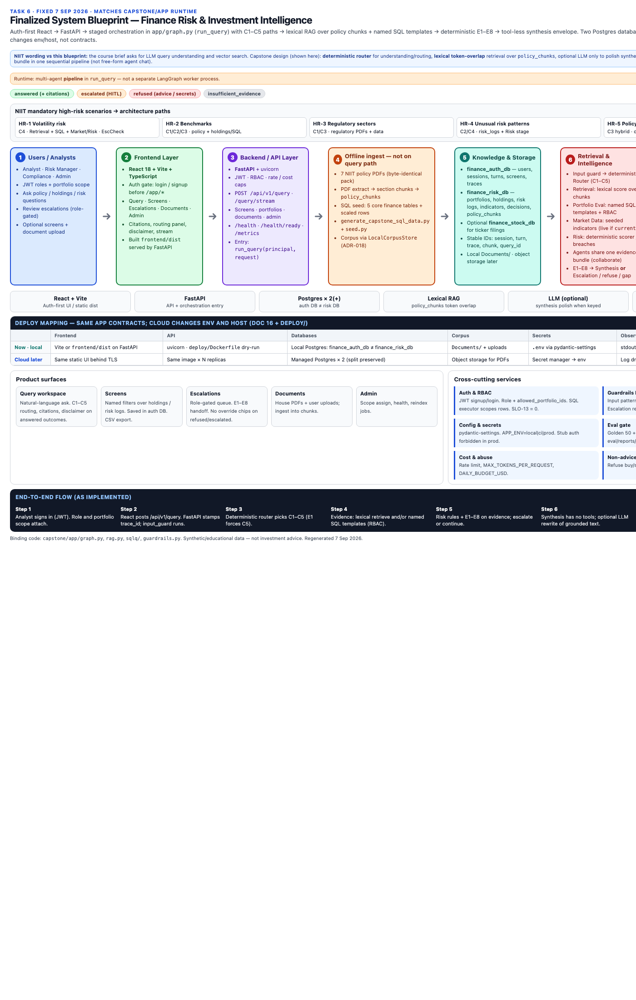
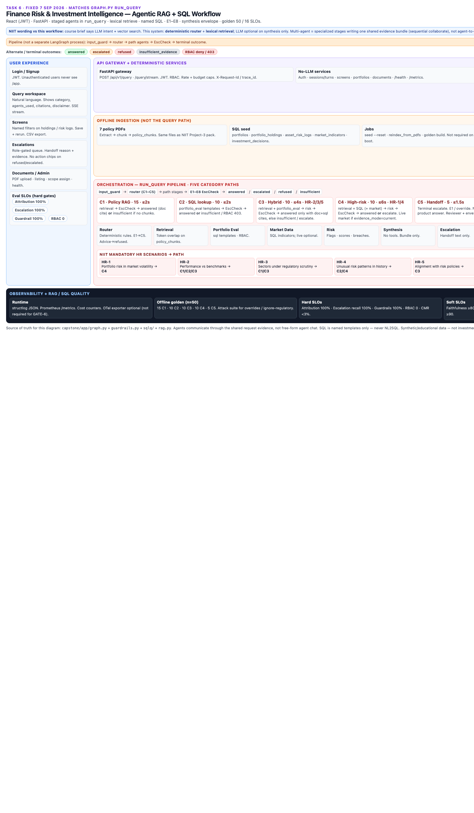
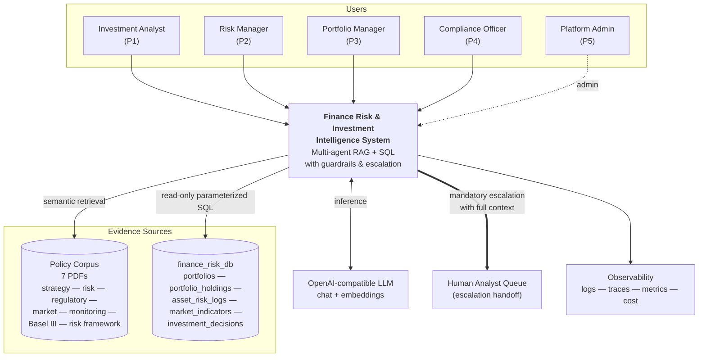
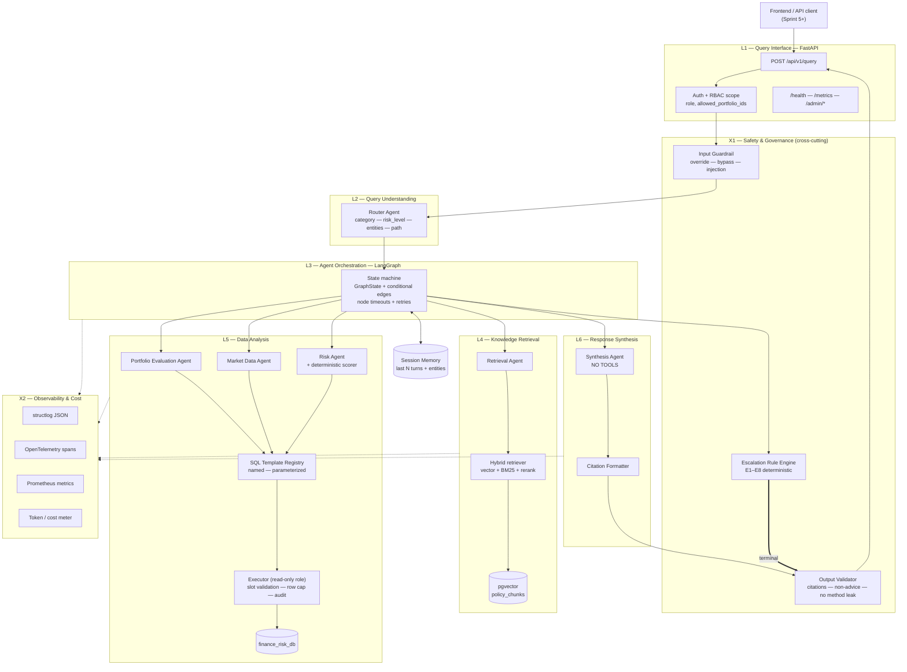
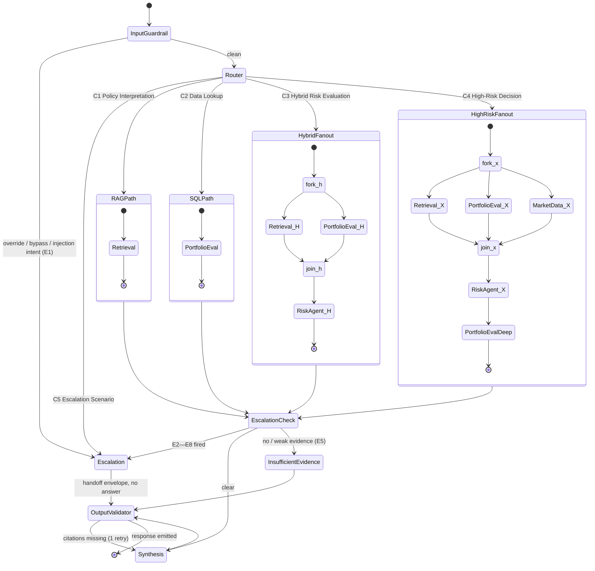
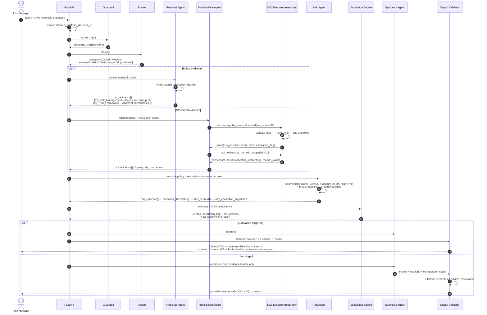
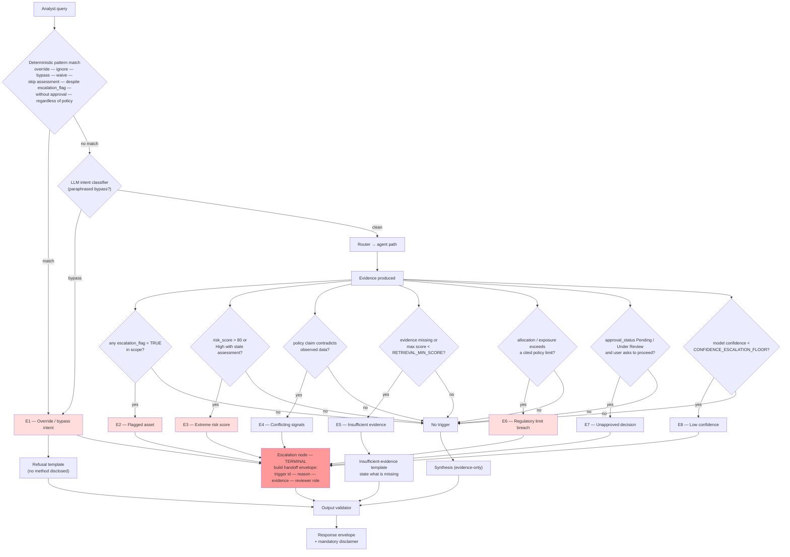
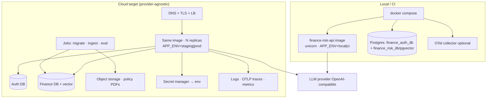

# 06 — High Level Architecture
**Task 6 — Sprint 2 — Foundation & Planning**

**Submission diagrams (lead):**
- Architecture — [`deliverables/diagrams/System_Blueprint.html`](deliverables/diagrams/System_Blueprint.html) · PNG [`png/09_system_blueprint.png`](deliverables/diagrams/png/09_system_blueprint.png)
- Workflow — [`deliverables/diagrams/Agentic_RAG_SQL_Workflow.html`](deliverables/diagrams/Agentic_RAG_SQL_Workflow.html) · PNG [`png/10_agentic_rag_sql_workflow.png`](deliverables/diagrams/png/10_agentic_rag_sql_workflow.png)
- Two-tab viewer — [`deliverables/diagrams/Task6_Architecture_and_Workflow.html`](deliverables/diagrams/Task6_Architecture_and_Workflow.html)

Older Excalidraw / C4 HTML stays in `deliverables/diagrams/` as backup. Narrative plus mermaid below is the binding detail.

---

## 1. Architectural Narrative

The system is a **FastAPI service fronting a LangGraph state machine** that reasons over two evidence
sources: a pgvector index of 7 financial policy PDFs, and the read-only `finance_risk_db` relational
store of portfolios, holdings, risk logs, market indicators, and investment decisions.

A request travels through four bands:

**Band 1 — Boundary.** FastAPI authenticates the caller, resolves `role` and `allowed_portfolio_ids`,
and stamps a `trace_id`. An input guardrail runs *before* any model call and classifies override /
bypass / injection intent. Nothing expensive happens until the request is known to be legitimate.

**Band 2 — Understanding.** A cheap, fast model plus a deterministic keyword pre-filter classifies the
query into one of five categories (C1 RAG, C2 SQL, C3 Hybrid, C4 High-Risk, C5 Escalation), assigns a
preliminary risk level, and extracts entities (portfolio, asset, sector, region, indicator, threshold,
date range). Category determines the path; path determines cost and latency. This is the single most
important accuracy lever in the system, which is why Query Routing Accuracy has its own 95% SLO.

**Band 3 — Execution.** LangGraph runs the path. Simple categories take one hop. Hybrid and High-Risk
categories fan out to Retrieval, Portfolio Evaluation, and Market Data **in parallel** (they have no
data dependency), then fan in to the Risk agent, which is the only component permitted to assign a
risk level. All agents write typed evidence into a shared `EvidenceBundle`; none of them talk to each
other directly. Deterministic escalation rules (E1–E8) are evaluated after every evidence-producing
node, so a `escalation_flag = TRUE` row or a policy-limit breach diverts the run to the Escalation
terminal node regardless of how far the reasoning has progressed.

**Band 4 — Synthesis and validation.** The Synthesis agent has **no tools**. It can only compose from
the evidence bundle, which is what makes Faithfulness measurable and Source Attribution Rate
enforceable at 1.0. An output validator then checks: every claim cited, no investment advice, no leaked
override method, disclaimer present. Failing validation replaces the answer with a refusal template
rather than shipping an uncited answer.

Cross-cutting, every node emits an OpenTelemetry span and a structured JSON log line with token and
cost accounting, so any answer can be reconstructed and explained after the fact — the auditability
requirement that a financial-governance context demands.

### Why this shape
| Force | Architectural response |
|---|---|
| 16 SLOs including four binary safety gates | Deterministic rule engine for safety; LLM only where judgement is genuinely needed |
| SQL Correctness >=95% | Named parameterized templates; no free-form text-to-SQL |
| Latency <=2s on common paths | Category-conditional depth: one hop for C1/C2, fan-out only for C3/C4 |
| Source Attribution Rate = 1.0 | Tool-less synthesis over a typed evidence bundle + post-hoc citation validator |
| Escalation Recall = 1.0 | Escalation is a deterministic pre-emptive graph transition, not a prompt instruction |
| Auditability | Span per node, evidence bundle persisted, replayable by `trace_id` |
| Small team, 4-week window | One database for both vector and relational; boring stack; no service mesh |

---

## 2. System Context (C4 Level 1)

---

## 3. Container / Layer View (C4 Level 2)

---

## 4. Agent Orchestration (LangGraph)

**Node budget note.** C1/C2 = 1 LLM reasoning call + 1 synthesis call (fits the 2s SLO). C3 = 2 parallel
evidence nodes + risk + synthesis. C4 = 3 parallel evidence nodes + risk + deep portfolio eval +
synthesis (documented 6s budget).

---

## 5. Hybrid RAG + SQL Flow (the signature capability)

Worked example: *"Are any assets exceeding the allowed risk thresholds for our portfolio strategy?"*

### What makes it "hybrid" rather than two systems
1. **Parallel fan-out** — policy and data are fetched concurrently, not sequentially.
2. **Reconciliation in the Risk agent** — the policy threshold (from a PDF) is compared numerically
   against the observed `risk_score` (from SQL). Neither source alone answers the question.
3. **Contradiction is a first-class output** — when policy and data disagree, the answer states both
   with both citations and, if a limit is breached, escalates.
4. **Dual citation** — every hybrid answer carries at least one `DOC:` and one `SQL:` citation.

---

## 6. Guardrail & Escalation Flow

**Design invariant:** escalation triggers are evaluated by **code, not prompts**. A prompt can be
talked out of escalating; an `if` statement cannot. This is the only way Escalation Recall = 1.0 and
Guardrail Effectiveness = 1.0 are achievable targets rather than aspirations.

---

## 7. Deployment View (local now → cloud later)

Same **image** and **schema** in every environment. Cloud move changes URLs, secrets, and orchestrator —
not agents. Detail: `16_Production_and_Cloud_Readiness.md` + ADR-015…018.

| Principle | Implication |
|---|---|
| Stateless app | Session memory in Postgres; scale by replica count; no sticky sessions |
| Two data stores | **`finance_auth_db`**: users/sessions · **`finance_risk_db`**: finance + `policy_chunks` (ADR-020) |
| Corpus portability | Ingest via `CorpusStore` (local FS → object storage) |
| Prod fail-fast | `APP_ENV=prod` rejects stub auth and placeholder secrets |
| Jobs ≠ runtime | Migrate/seed/ingest are CLI/jobs; container `CMD` is API only |

## 8. Architectural Invariants (must hold in every sprint)
1. Synthesis has no tools; it composes only from the evidence bundle.
2. Only the Risk agent assigns a risk level.
3. No SQL reaches the database except through a named parameterized template executed by a
   SELECT-only role.
4. Escalation checks are deterministic and run after every evidence-producing node.
5. Every response carries at least one resolvable citation, or it is a refusal.
6. Agents communicate only through `GraphState` — no direct agent-to-agent messaging.
7. Every node emits a span; every request emits a structured log line with cost.
8. Every response carries the non-advice disclaimer.
9. Live market/news run only when the user sets `evidence_mode=current` **and** providers are configured. Default and capstone path is `corpus` (PDFs + SQL). This is a per-query switch, not `APP_MODE`.

---

> **Disclaimer.** Synthetic/educational data. Not investment advice.
