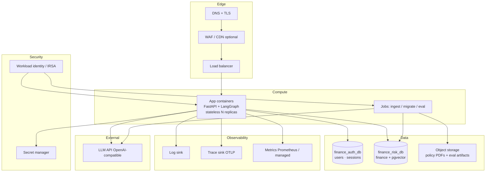

# 16 — Production Grade & Cloud Readiness (Capstone engineering)
**Cross-cutting — binds Sprints 4–10; reviewed at Gate 4 (T48) and Gate 6 (T56)**

Build local for the capstone, but **design as if it will run in a cloud VPC next quarter**.
This doc = **engineering** readiness for the **capstone** deployable. User-owned + RT market product plan is separate: `production/` (ADR-022).
Cloud move = change env, secrets, and deploy target — **not** a rewrite of agents, SQL, or RAG.

Binding decisions: ADR-015 … ADR-018, **ADR-020** (auth DB ≠ vector DB) in `07_ADR.md`.

---

## 1. Production bar (non-negotiable)

| Area | Local (now) | Production (must already be designed for) |
|---|---|---|
| App shape | Docker + uvicorn | Same container image; N replicas behind TLS LB |
| State | Two DBs in compose (`finance_auth_db`, `finance_risk_db`) | Auth DB + Finance/vector DB (managed; vector only on finance) |
| Config | `.env` file | Env vars from platform + secret manager — no baked secrets |
| Auth | `AUTH_MODE=stub` | `AUTH_MODE=jwt` with **signup + login**; OIDC later — same RBAC matrix |
| Observability | JSON logs + OTel optional | Always-on structured logs, traces, Prometheus `/metrics` |
| Health | `/health`, `/health/ready` | Ready checks gate traffic; DB + LLM probe in ready |
| SQL | SELECT-only role | Same role; no app role with DDL/DML on business tables |
| Escalation / guardrails | Deterministic E1–E8 | Unchanged — safety is not environment-specific |
| Cost | Logged | Soft + hard budget caps enforced (Sprint 8) |
| Deploy | `docker compose up` | Same image ? ECS/Cloud Run/ACA/GKE/AKS (pick one later) |

**Rule:** if a feature only works on localhost filesystem paths, absolute machine paths, or
compose service DNS hardcoded in Python, it is not prod-grade — fix before Gate 4.

---

## 2. Twelve-factor / cloud-portability checklist

Enforce from Sprint 4 onward (cheap now, expensive later):

1. **One codebase, three configs:** `APP_ENV=local|ci|prod` — behavior differences only via config.
2. **Explicit dependencies:** pinned `requirements.txt` (+ lock preferred); no global pip hope.
3. **Config in env:** `pydantic-settings`; fail fast if required vars missing.
4. **Backing services as attached resources:** Postgres URL, LLM base URL, OTel endpoint are URLs — swap host, not code.
5. **Stateless processes:** no local disk for session/evidence; uploads/corpus live in `data/` locally and object storage in cloud (see §4).
6. **Disposable containers:** image builds clean; schema/migrate + ingest are separate jobs, not `CMD` side effects.
7. **Logs to stdout:** structlog JSON ? platform log drain. No writing `logs/app.log` as the primary sink.
8. **Admin as jobs:** reindex / seed / eval are CLI (`make …`) or `/admin/*` with auth — not manual SSH edits.
9. **Dev/prod parity:** same Postgres major + pgvector; same migration SQL; golden eval runnable in CI.
10. **Fast startup / graceful shutdown:** uvicorn workers respect SIGTERM; in-flight query timeout bounded.

---

## 3. Target cloud architecture (provider-agnostic)



**Why this shape:** one stateful system (Postgres). App and jobs are replaceable. LLM stays external.
No cloud-vendor SDK required in the agent path — only optional SDK for secrets/object storage adapters.

---

## 4. What stays the same vs what swaps on cloud move

| Concern | Capstone (local/CI) | Cloud later | Code impact |
|---|---|---|---|
| Orchestration | LangGraph | Same | None |
| Auth / users | `finance_auth_db` | Managed auth Postgres (no vector) | `AUTH_DATABASE_URL` |
| Finance + vectors | `finance_risk_db` + pgvector | Managed Postgres + vector | `DATABASE_URL` |
| Equity screens | `equity_*` tables in finance DB | Same finance DB | Screen runner only |
| Corpus files | `Documents/` / `data/documents` | Object storage + sync/ingest job | `rag/ingest.py` reads via `CorpusStore` interface |
| Secrets | `.env` | Secret manager ? env injection | None if already env-based |
| Auth | stub JWT | Real JWT/OIDC issuer | `AUTH_MODE` + JWKS URL |
| Observability | local collector | Cloud OTLP + log drain | Endpoint URL |
| Frontend | static/spa | Same behind CDN or colocated | None |
| Deploy | compose | Container service / K8s | Manifests only (`deploy/`) |

Interface to add early (thin — no framework):

```text
app/core/storage.py   # Protocol: get_bytes(key) / list(prefix)
  LocalCorpusStore    # filesystem
  S3CompatibleStore   # optional later; unused until cloud
```

Do **not** implement S3 until needed; **do** route ingest through the Protocol so the swap is one class.

---

## 5. Environments

| Env | Purpose | Data | Auth | LLM |
|---|---|---|---|---|
| `local` | Dev | Synthetic seed | stub | Dev key / cheap models |
| `ci` | PR gates | Ephemeral compose DB + golden | stub | Mock or recorded fixtures preferred; live key only for nightly |
| `staging` | Pre-prod (cloud) | Synthetic or anonymized | JWT staging issuer | Real models, budget capped |
| `prod` | Live | Institution data (future) | JWT/OIDC | Real models, hard budget + alert |

**Never** point `local` tools at prod DB. `APP_ENV=prod` must refuse default passwords and `AUTH_MODE=stub`.

---

## 6. Production readiness checklist (Gate 4 / T48)

### Runtime
- [ ] Multi-stage `Dockerfile` (builder + slim runtime); non-root user; no secrets in layers
- [ ] `docker compose` for local; image tagged `finance-risk-api:<git-sha>`
- [ ] `/health` liveness (process up); `/health/ready` checks DB pool + migrations applied
- [ ] Graceful shutdown: drain ? `NODE_TIMEOUT_MS` then exit
- [ ] Connection pooling (`asyncpg`/`psycopg` pool); pool size from env
- [ ] Read-only DB role used by query path; migrate role separate (never in app runtime)

### Security
- [ ] Secrets only via env / secret manager; `.env` gitignored
- [ ] TLS terminated at edge in cloud; HSTS when behind HTTPS
- [ ] `AUTH_MODE=jwt` path tested; stub blocked when `APP_ENV=prod`
- [ ] RBAC executor tests: 0 unauthorized row leaks (ADR-014)
- [ ] Dependency scan (pip-audit / equivalent) in CI; critical CVEs block merge
- [ ] Admin routes require `admin` role; reindex not publicly callable
- [ ] Rate limit / body size limits on `/api/v1/query`

### Safety / finance domain
- [ ] E1–E8 unit + attack suite green; Escalation Recall = 1.0
- [ ] Guardrail effectiveness = 1.0 on attack suite
- [ ] Source Attribution Rate = 1.0 on golden
- [ ] Non-advice disclaimer on every successful and refusal response

### Observability & ops
- [ ] JSON logs with `trace_id`, `request_id`, `category`, `latency_ms`, `cost_usd`, `escalated`
- [ ] OTel spans per graph node
- [ ] Prometheus metrics: request count, latency histogram by category, escalation count, LLM tokens
- [ ] Runbooks in `05` still valid against container logs (no SSH required for diagnosis)
- [ ] Cost guardrails: `MAX_TOKENS_PER_REQUEST`, `DAILY_BUDGET_USD` enforced

### Performance
- [ ] Load test: per-category p95 within ADR-010 budgets
- [ ] Horizontal scale smoke: 2 app replicas, sticky sessions **not** required
- [ ] DB indexes present; `EXPLAIN` on hot templates reviewed once

### Release
- [ ] Migrations idempotent; rollback note for last migration
- [ ] `deploy/` folder with cloud-agnostic sketches (compose-prod + K8s or ECS task def stubs)
- [ ] Production Readiness Review signed (T48)

---

## 7. Cloud migration runbook (post-capstone / Sprint 10+)

1. Provision managed Postgres 16 with `vector`; restore schema + data or re-seed + re-ingest.
2. Create secret manager entries matching `.env.example` keys.
3. Push image to registry; deploy service with CPU/mem requests, min 2 tasks, health checks on `/health/ready`.
4. Point DNS + TLS; set `APP_ENV=prod`, `AUTH_MODE=jwt`, real `JWT_*` / OIDC.
5. Wire OTLP exporter to managed collector; confirm one golden query appears in traces.
6. Upload PDFs to object storage; run ingest job once; verify chunk counts.
7. Run full golden + attack suite against staging; promote only if Gate 6 SLOs hold.
8. Enable budget alerts; document on-call for escalation-miss P0 (same runbook as local).

**Out of scope for first cloud cut:** multi-region active-active, fine-tuned models.
**Real-time + user workspace:** out of this doc — see `planning/production/`.

---

## 8. Suggested `deploy/` layout (create in Sprint 8–10)

```text
deploy/
  Dockerfile                 # or root Dockerfile — one image only
  compose.prod.yml           # app + optional otel; DB external
  k8s/                       # optional sketches
    deployment.yaml
    service.yaml
    configmap.yaml           # non-secret config only
    secret.example.yaml      # placeholder keys, not values
  terraform/ or bicep/       # optional later — do not block capstone
    README.md                # "provider TBD; resources listed"
```

Keep IaC thin until a cloud provider is chosen. **List resources, don’t invent three clouds’ worth of HCL.**

---

## 9. Definition of done for “prod-grade + cloud-ready”

| Claim | Evidence |
|---|---|
| Prod-grade | Gate 4 checklist complete; load + security + SLO report committed |
| Cloud-ready | Stateless image; env-only config; managed-Postgres-compatible schema; `CorpusStore` seam; `deploy/` stubs; migration runbook above exercised on staging or documented dry-run |

---

> **Disclaimer.** Synthetic/educational data. Not investment advice. Cloud deployment does not change the non-advice or escalation obligations.
