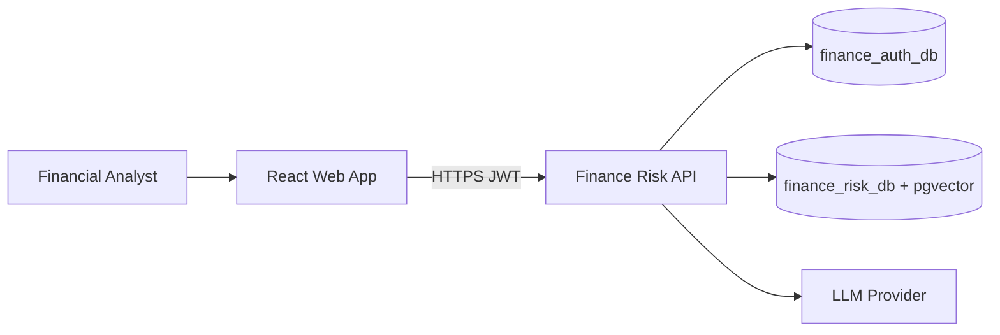
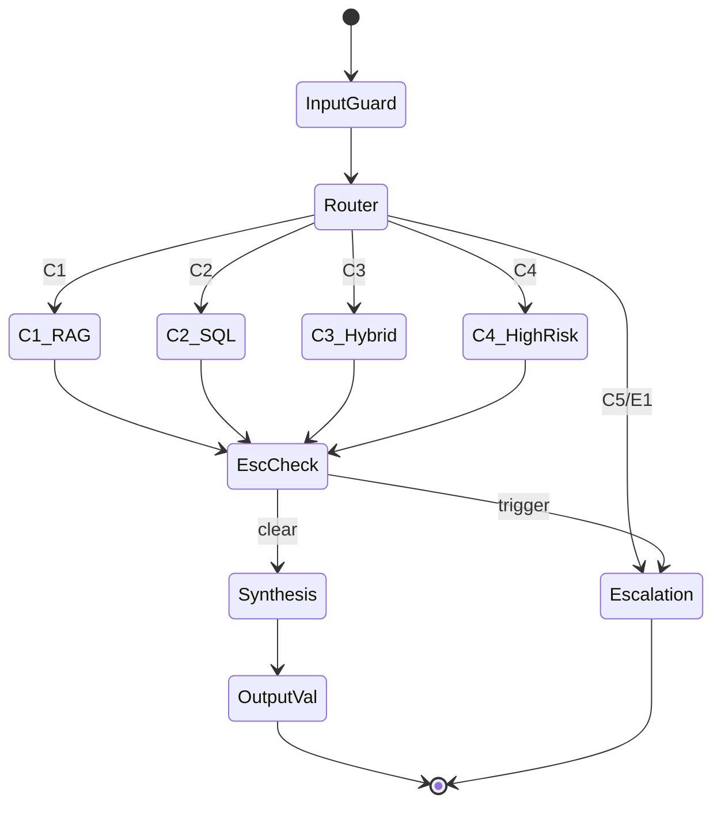

# Architecture (v2)

C4-style view. Binding decisions: `../07_ADR.md`.

---

## 1. System context (C4 L1)

---

## 2. Containers (C4 L2)

| Container | Responsibility | Tech |
|---|---|---|
| **Web** | Auth-first UX, query, screens, citations | React + Vite + TS |
| **API** | HTTP, auth, orchestration entry | FastAPI |
| **Orchestrator** | LangGraph state machine, agents | LangGraph |
| **RAG** | Ingest, hybrid retrieve, rerank | pgvector + FTS |
| **SQLQ** | Template registry, executor, RBAC | async Postgres |
| **Guardrails** | Input filter, E1–E8, output validate | Python (deterministic) |
| **Eval** | Golden run, metrics, reports | Python CLI |

---

## 3. Agent topology

| Agent | Writes to state | Tools |
|---|---|---|
| Router | category, entities, risk_hint | none (LLM classify) |
| Retrieval | doc_evidence[] | retriever |
| Portfolio Eval | sql_evidence[] | sql templates |
| Market Data | market_evidence[] | sql templates |
| Risk | risk_evidence[], risk_level | sql + rules |
| Synthesis | answer, citations | **none** |
| Escalation | handoff envelope | **none** (summary only) |

### Evidence mode (per query)

Not an `APP_MODE` for the whole app. The caller picks sources on each `POST /query`:

| Mode | Sources | Capstone |
|---|---|---|
| `corpus` (default) | Policy PDFs + SQL templates | Always |
| `current` | Corpus + live quotes + news adapters | Off — 409 unless `CURRENT_FACTORS_ENABLED` |

Market Data agent in capstone still reads **seeded** `market_indicators` via SQL. Live adapters are production-only and run only when the user selects `current`.

---

## 4. Data stores

| Database | Contents | Vector |
|---|---|---|
| `finance_auth_db` | users, sessions, turns, saved_screens | No |
| `finance_risk_db` | 5 finance tables, policy_chunks, equity_* | Yes (policy_chunks only) |

---

## 5. Key invariants

1. Only Risk agent assigns risk level.
2. SQL only via named templates + SELECT role.
3. Escalation checks after every evidence node.
4. Agents communicate via `GraphState` only.
5. Answered outcome ⇒ ≥1 resolvable citation.
6. **Refactor is eval-gated:** prompts/rules/tools change only when an SLO score is below target or regresses (`08` §6).

Detail: v1 `../10_Detailed_Solution_Design.md` (GraphState schema, E1–E8, templates).

---

## 6. Deployment (capstone)

Docker Compose: Postgres (both DBs), API container, optional OTel. React dev server or static build served by API/CDN. Cloud-ready: `../16_Production_and_Cloud_Readiness.md`.
